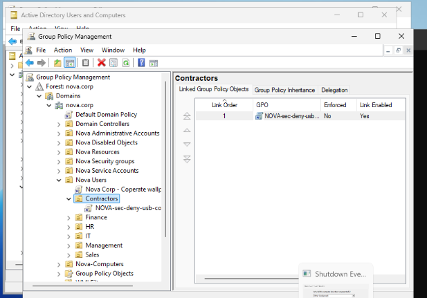
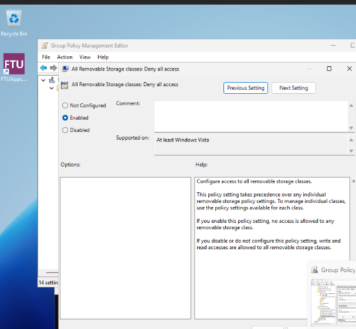
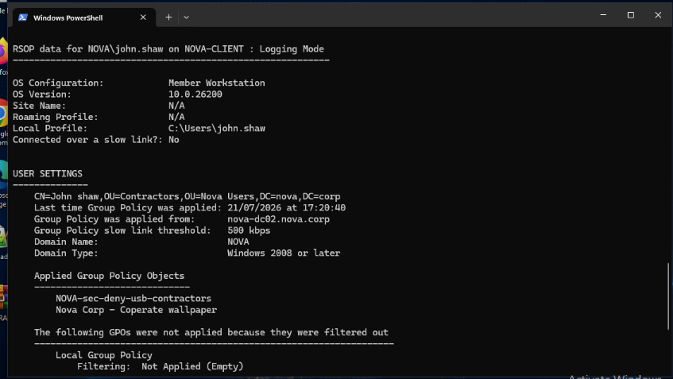
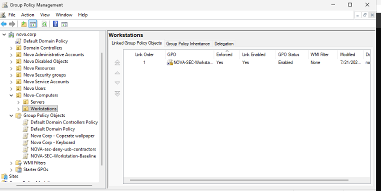
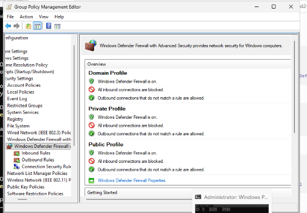
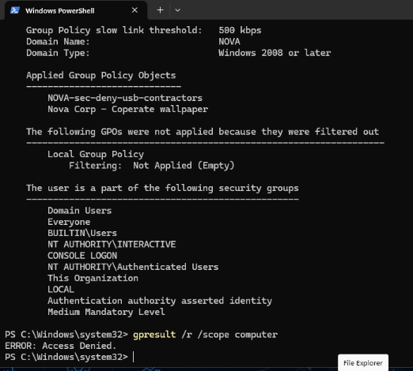
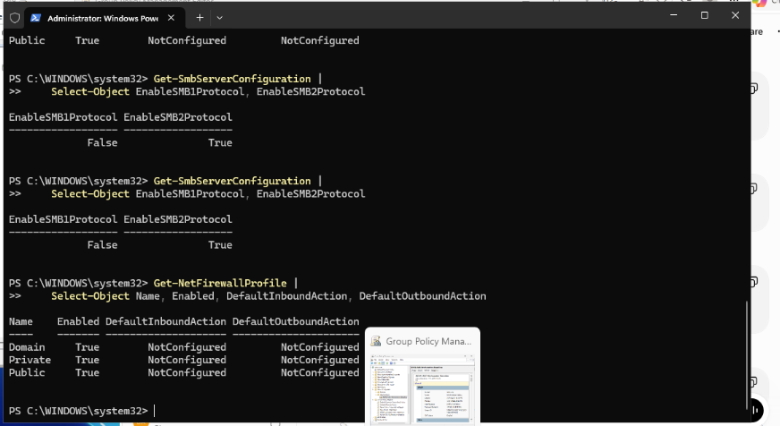

# CR-006 - Group Policy Management and Windows Workstation Security

## Change record

| Field | Value |
|---|---|
| Change ID | CR-006 |
| Title | Group Policy Management and Windows Workstation Security |
| Project | Nova Corp Enterprise Infrastructure Lab |
| Engineer | David Eti |
| Technical reviewer / mentor | Nova |
| Environment | `nova.corp` Active Directory lab |
| Primary domain controller | `nova-dc01` |
| Validation workstation | `NOVA-CLIENT` |
| Implementation period | July 2026 |
| Final validation date | 21 July 2026 |
| Change type | Planned security and configuration change |
| Risk level | Medium, with potentially high blast radius if incorrectly scoped |
| Final status | **Passed with one deferred physical validation item** |
| Next dependent change | CR-007 - Remote Access VPN and External Workstation Integration |

---

## 1. Executive summary

CR-006 established the first structured Group Policy management standard for the Nova Corp Windows environment. The work moved beyond creating isolated GPO settings and focused on how enterprise policies should be designed, scoped, validated, troubleshot, and documented.

The change delivered or formally established:

- Domain password and account-lockout controls.
- A corporate wallpaper policy.
- A contractor-specific removable-storage restriction.
- A scalable USB exception design based on security-group membership.
- A modular workstation security baseline.
- Windows Defender Firewall configuration for Domain, Private, and Public profiles.
- AutoRun and AutoPlay restrictions.
- SMBv1 server-protocol disablement on the validation workstation.
- Correct use of OUs, security groups, security filtering, inheritance, link order, and the **Enforced** option.
- A repeatable GPO troubleshooting workflow using `gpresult`, Resultant Set of Policy, Group Policy reports, Active Directory inspection, firewall policy stores, and event/replication tools.
- A tabletop incident simulation involving an incorrectly scoped user-lockdown GPO.
- Formal documentation of rollback, validation evidence, residual risk, and a deferred USB test.

The most important outcome was not a single setting. It was the adoption of a maintainable Group Policy operating model:

> Apply policies only to the intended population, separate settings by responsibility, validate the effective result, and do not treat configuration as complete until the business outcome is proven.

---

## 2. Business reason

Nova Corp is preparing to manage a growing Windows workstation estate. Manual configuration of each workstation would create inconsistent security, increase technician workload, and make troubleshooting difficult.

Management required a centralized mechanism that could:

- Apply consistent security settings automatically.
- Differentiate between departments and roles.
- Keep administrative tools available to IT while restricting them for standard users where justified.
- Reduce malware and data-loss risk from removable storage and automatic execution.
- Disable legacy protocols.
- Provide evidence showing which policy actually won on a client.
- Scale from the current small lab to a future environment containing hundreds of users and computers.

This CR implemented that mechanism through Active Directory Group Policy.

---

## 3. Source requirements and scope alignment

The Nova Corp infrastructure guide requires Phase 2 to cover:

- Password policy.
- Account lockout.
- Corporate wallpaper.
- USB restriction.
- Windows Firewall policy.
- SMBv1 disablement.
- GPO refresh and validation using `gpupdate`, `gpresult`, and RSOP.
- Troubleshooting a GPO that does not apply correctly.

The operational-enhancements guide also requires every major change to document:

- Purpose.
- Risk.
- Validation steps.
- Rollback procedure.
- Result and lessons learned.

### 3.1 Included in CR-006

- GPO design fundamentals and processing order.
- Password and lockout baseline.
- Corporate wallpaper.
- Contractor USB restriction.
- USB authorization and exception design.
- Workstation firewall, AutoRun/AutoPlay, and SMBv1 baseline.
- Validation and troubleshooting.
- Failure simulation and incident-response process.
- GPO design standards for future Nova Corp changes.

### 3.2 Explicitly excluded from CR-006

Application allowlisting was discussed but deliberately removed from this CR to prevent scope expansion. The following belong in a dedicated future **Application Control and Endpoint Protection** change:

- Software Restriction Policies (SRP).
- AppLocker.
- Windows Defender Application Control (WDAC).
- Publisher, path, hash, and certificate rules.
- Controlled Folder Access.
- Approved software deployment and allowlisting operations.

This was a change-management decision: one CR should retain one clear scope.

---

## 4. Environment and affected objects

### 4.1 Active Directory domain

```text
nova.corp
```

The original guide uses `nova.local`, but the deployed lab domain is `nova.corp`. This document records the actual implementation.

### 4.2 Relevant OU structure

```text
nova.corp
|
+-- Nova Administrative Accounts
+-- Nova Disabled Objects
+-- Nova Resources
+-- Nova Security groups
+-- Nova Service Accounts
+-- Nova Users
|   +-- Contractors
|   +-- Finance
|   +-- HR
|   +-- IT
|   +-- Management
|   +-- Sales
|
+-- Nova-Computers
    +-- Servers
    +-- Workstations
```

### 4.3 Relevant users and computers

| Object | Type | Location / use |
|---|---|---|
| `john.shaw` | Contractor test user | `OU=Contractors,OU=Nova Users,DC=nova,DC=corp` |
| `admin.david` | Simulated IT administrator | IT OU; used in CP-8 tabletop scenario |
| `NOVA-CLIENT` | Windows member workstation | `nova.corp/Nova-Computers/Workstations` |

### 4.4 GPOs referenced in this CR

| GPO | Purpose | Implementation status |
|---|---|---|
| `Default Domain Policy` | Domain password and lockout baseline | Configured earlier in CR-006 |
| `Nova Corp - Corporate wallpaper` | Standard corporate wallpaper | Implemented and observed in user `gpresult` |
| `NOVA-sec-deny-usb-contractors` | Absolute removable-storage denial for contractors | Implemented and validated at policy-processing level |
| `NOVA-SEC-Workstation-Baseline` | Computer-level workstation hardening | Implemented and validated |
| `NOVA-SEC-User-Lockdown` | Restrict CMD, PowerShell, Registry Editor, and Control Panel | Tabletop incident object; not applied as a real change during CP-8 |
| `NOVA-GG-Restricted-Users` | Approved security-filtering target for user lockdown | Corrective design from tabletop incident |
| `USB_Authorized` | Approved exception group for legitimate USB users | Approved design; end-to-end physical validation deferred |

---

## 5. Risk assessment

### 5.1 Primary risks

| Risk | Potential impact | Mitigation used |
|---|---|---|
| A GPO is linked too high in the hierarchy | Entire departments or all users receive an unintended restriction | Inspect link location, inheritance, and `gpresult` before changing settings |
| A user restriction affects IT administrators | Loss of PowerShell, CMD, Registry Editor, or Control Panel during support work | Use security filtering and role-based groups instead of broad `Authenticated Users` targeting |
| Firewall rules block required management traffic | Remote administration or domain communication may fail | Configure default behavior carefully, validate effective ActiveStore, avoid unnecessary custom inbound rules in this CR |
| USB policy blocks legitimate business use | Media, graphics, or approved staff cannot transfer required files | Deny by default with controlled `USB_Authorized` group exceptions |
| An exception accidentally grants contractors USB access | Data-exfiltration and malware risk | Dedicated absolute-deny GPO linked to Contractors OU; contractor restriction does not recognize the normal exception group |
| SMBv1 disablement breaks a legacy dependency | Old devices or software may stop communicating | Validate current environment, document rollback, and avoid re-enabling without an approved exception |
| `Enforced` prevents legitimate child-OU exceptions | Future developer, kiosk, lab, or IT policies cannot be cleanly adjusted | Do not use Enforced by default; it was removed from the workstation baseline link |
| Troubleshooting refresh destroys evidence | The original policy state may change before it is captured | Collect `gpresult`, RSOP, timestamps, and logs before `gpupdate /force` where possible |

### 5.2 Change risk conclusion

The change was classified as medium risk because the settings themselves were common enterprise controls, but an incorrectly linked or filtered GPO could affect many users at once. The modular design, direct OU targeting, non-enforced links, staged validation, and test accounts reduced the risk.

---

## 6. Approved Group Policy design standards

The following standards were adopted during CR-006 and now apply to future Nova Corp GPO work.

### 6.1 Modular GPO design

Do not create one large "Corporate Policy" GPO containing unrelated settings. Each GPO must have a clear responsibility.

Recommended pattern:

```text
NOVA-SEC-Workstation-Baseline
NOVA-SEC-User-Lockdown
NOVA-SEC-Deny-USB-Contractors
NOVA-IT-Admin-Workstation
NOVA-Contractor-Restrictions
```

This makes ownership, rollback, and troubleshooting easier.

### 6.2 Separate user and computer configuration

Computer settings follow the computer account and belong on computer OUs. User settings follow the user and belong on user OUs or use security filtering.

Examples:

```text
Computer Configuration
- Firewall
- AutoRun / AutoPlay
- SMB protocol settings
- Defender
- Windows Update

User Configuration
- PowerShell / CMD restrictions
- Registry Editor restrictions
- Control Panel restrictions
- Wallpaper
- User-specific removable-storage restriction
```

### 6.3 OUs are containers; security groups grant or target access

An OU cannot be added to a security group. OUs organize users and computers and provide GPO link points. Security groups are used for permissions, authorization, exceptions, and security filtering.

Correct model:

```text
User in any department OU
        |
        +-- Member of USB_Authorized
                |
                +-- Receives approved USB exception
```

### 6.4 Apply to intended users instead of applying broadly and reversing later

A child-OU GPO can override a conflicting parent setting when the parent is not Enforced. However, using repeated "allow" GPOs to reverse a broadly applied restriction creates complexity.

Preferred pattern:

```text
Restricted population group
        |
        +-- Apply NOVA-SEC-User-Lockdown

IT user not in restricted group
        |
        +-- Lockdown never applies
```

### 6.5 Do not use Enforced by default

Use **Enforced** only when a documented compliance or business requirement says the policy must survive conflicting child-OU policies and Block Inheritance.

For normal baselines:

```text
Link Enabled: Yes
Enforced: No
```

The workstation baseline was initially shown as Enforced and was corrected to **Enforced = No**.

### 6.6 Validate both policy application and business outcome

A GPO appearing in `gpresult` proves policy processing. It does not always prove the requested business result.

Required validation layers:

```text
1. Configuration exists
2. GPO is linked correctly
3. RSoP shows it applied
4. Effective operating-system state is correct
5. User-facing business behavior is correct
```

---

# 7. Checkpoint execution record

## CP-1 - Group Policy fundamentals

### Objective

Understand what a GPO is, where it can be linked, and why scope is as important as the setting itself.

### Concepts established

- A GPO contains policy settings.
- A GPO does nothing until linked or otherwise scoped.
- GPOs may be linked to a site, domain, or OU.
- Users and computers process different halves of a GPO.
- Security Filtering controls which principals have `Read` and `Apply Group Policy`.
- WMI filters can narrow computer targeting but should not be added without a real need.
- A GPO showing as "linked" does not automatically prove it applied to the intended account.

### Engineering lesson

The first troubleshooting question should not be "Is the setting configured?" It should be:

> Which user or computer is in scope, and which GPO is the winning source of the effective setting?

---

## CP-2 - GPO processing, inheritance, and precedence

### Processing model

The standard processing order was studied as:

```text
Local
  -> Site
     -> Domain
        -> Parent OU
           -> Child OU
```

This is commonly remembered as **LSDOU**.

A later policy can win when two GPOs configure the same setting, subject to:

- Link order.
- OU depth.
- Enforced links.
- Block Inheritance.
- Security filtering.
- WMI filtering.
- User vs. computer scope.

### Key design exercise

A contractor must never use USB storage, even if accidentally added to the ordinary USB authorization group.

The approved approach was:

- Create a dedicated contractor USB-deny GPO.
- Link it directly to the Contractors OU.
- Use User Configuration so the restriction follows the contractor to any workstation.
- Do not grant a `USB_Authorized` exemption in the contractor policy.
- Consider Enforced only if child OUs are later created and the absolute requirement must survive conflicting lower-level links.

### Terminology correction

"Prevent Override" is the older term. Modern Group Policy Management uses **Enforced**.

---

## CP-3 - Corporate wallpaper policy

### Purpose

Provide a consistent Nova Corp desktop identity and prove that a user-level GPO follows a domain user to a managed workstation.

### GPO

```text
Nova Corp - Corporate wallpaper
```

### Configuration class

```text
User Configuration
```

### Typical policy path used for this control

```text
User Configuration
-> Policies
-> Administrative Templates
-> Desktop
-> Desktop
-> Desktop Wallpaper
```

### Validation

The wallpaper GPO appeared in the applied user-policy list for `john.shaw` on `NOVA-CLIENT`:

```text
Applied Group Policy Objects
----------------------------
NOVA-sec-deny-usb-contractors
Nova Corp - Corporate wallpaper
```

This proved that:

- User policy processing was working.
- The test user was receiving inherited/shared corporate policy in addition to the contractor-specific policy.
- Multiple modular GPOs could apply to the same user without being combined into one large GPO.

> Note: The current evidence package records policy application. The exact wallpaper UNC/file path was configured during the earlier checkpoint but was not included in the screenshots supplied for final documentation.

---

## CP-4 - Password and account-lockout policy

### Purpose

Reduce weak-password and brute-force risk at the domain level.

### Approved baseline

```text
Minimum password length: 12 characters
Password complexity: Enabled
Maximum password age: 90 days
Account lockout threshold: 5 invalid attempts
Account lockout duration: 15 minutes
Reset lockout counter after: 15 minutes
```

Repeated lockouts should be escalated for investigation rather than treated only as password-reset requests.

### Scope decision

Domain account policy belongs in the domain password-policy location and should not be duplicated across departmental GPOs. A domain-wide account-policy change has a large blast radius and must be backed up and validated before closure.

### Recommended validation commands

```powershell
Get-ADDefaultDomainPasswordPolicy |
    Format-List MinPasswordLength, ComplexityEnabled, MaxPasswordAge,
                LockoutThreshold, LockoutDuration, LockoutObservationWindow
```

```cmd
net accounts /domain
```

### Operational test concept

- Confirm a new password shorter than the minimum is rejected.
- Confirm five incorrect attempts trigger lockout.
- Confirm the lockout can be identified with AD tools.
- Confirm the intended recovery process works.

The full account-lockout incident remains part of the later Phase 2 incident exercises.

---

## CP-5 - USB device restrictions

### 7.5.1 Business requirement

Removable USB storage creates several risks:

- Data exfiltration.
- Malware introduction.
- Ransomware execution.
- Loss of confidential company information.

The approved organizational principle was:

> USB storage is denied by default. Access is granted only to explicitly authorized staff with a legitimate business need.

The engineer correctly identified that some non-IT roles, such as media or graphics staff, may require USB access. Therefore, "IT only" was rejected in favor of a role-based exception group.

### 7.5.2 Approved exception design

```text
Security group: USB_Authorized
```

Users from any OU can be added to this group when approved. An OU itself cannot be placed in the group.

Example workflow:

```text
Approved request received
        -> Add named user to USB_Authorized
        -> Refresh policy / re-authenticate as required
        -> Validate access
        -> Record approval and expiry/review date
```

### 7.5.3 Absolute contractor restriction

Contractors must never receive USB storage access, even when they are accidentally added to the normal exception group.

Implemented GPO:

```text
NOVA-sec-deny-usb-contractors
```

Link location:

```text
Nova Users
`-- Contractors
```

Configuration path:

```text
User Configuration
-> Policies
-> Administrative Templates
-> System
-> Removable Storage Access
-> All Removable Storage classes: Deny all access
```

Configured value:

```text
Enabled
```

The user-side setting was chosen because it follows the contractor account to every workstation. A computer-side restriction applied only to "contractor computers" could be bypassed when the contractor logs on to another workstation.

### 7.5.4 Link validation evidence



**Figure 1 -** `NOVA-sec-deny-usb-contractors` linked directly to the Contractors OU. The link is enabled and not Enforced.

### 7.5.5 Setting evidence



**Figure 2 -** `All Removable Storage classes: Deny all access` configured as Enabled.

### 7.5.6 RSoP / gpresult validation

Test user:

```text
NOVA\john.shaw
```

Distinguished-name location shown by `gpresult`:

```text
CN=John Shaw,OU=Contractors,OU=Nova Users,DC=nova,DC=corp
```

Applied GPOs:

```text
NOVA-sec-deny-usb-contractors
Nova Corp - Corporate wallpaper
```



**Figure 3 -** The contractor-specific USB policy and corporate wallpaper policy both applied to `john.shaw`.

### 7.5.7 Physical test limitation

A physical USB drive could not be passed reliably through the nested virtualization chain:

```text
Physical Windows host
-> VMware Workstation
-> Proxmox VE
-> NOVA-CLIENT VM
```

The limitation was not hidden or converted into a false pass.

Recorded result:

```text
Configuration validation: PASSED
GPO application validation: PASSED
Physical USB access test: DEFERRED
```

The physical test will be completed in CR-007 after a Windows PC outside Proxmox is connected through the Nova Corp VPN and joined to `nova.corp`.

---

## CP-6 - Workstation security baseline

### 7.6.1 Design decision: one large GPO vs. modular GPOs

A single large GPO was rejected because the settings have different owners, scopes, risks, and exception requirements.

The engineer identified that:

- Firewall, Windows Update, SMB, Defender, and AutoRun controls are machine-level baseline controls.
- PowerShell, CMD, Registry Editor, and Control Panel restrictions are role-dependent user controls.
- IT and development staff may legitimately require administrative tools that standard office users do not.

Approved design:

```text
NOVA-SEC-Workstation-Baseline
- Firewall
- AutoRun / AutoPlay
- SMBv1
- Future Defender and update settings

NOVA-SEC-User-Lockdown
- CMD
- PowerShell
- Registry Editor
- Control Panel

NOVA-IT-Admin-Workstation
- IT-specific management capability

NOVA-Contractor-Restrictions
- Contractor-specific controls
```

### 7.6.2 Implemented GPO

```text
NOVA-SEC-Workstation-Baseline
```

Link location:

```text
Nova-Computers
`-- Workstations
```

The computer account, not the logged-in user, must be in this OU for the computer-side baseline to apply.



**Figure 4 -** The baseline GPO linked to `Workstations`. The screenshot initially showed Enforced = Yes; this was subsequently corrected to **Enforced = No**.

### 7.6.3 AutoPlay and AutoRun

Configuration path:

```text
Computer Configuration
-> Policies
-> Administrative Templates
-> Windows Components
-> AutoPlay Policies
```

Settings:

```text
Turn off AutoPlay: Enabled
Turn off AutoPlay on: All drives

Set the default behavior for AutoRun: Enabled
Behavior: Do not execute any autorun commands
```

Reason:

- AutoPlay controls automatic prompts/actions when media is inserted.
- AutoRun controls execution instructions such as those historically supplied through `autorun.inf`.
- Disabling both reduces the chance that removable media automatically launches unwanted code.

### 7.6.4 SMBv1

A Group Policy Preferences registry item was created:

```text
Action: Update
Hive: HKEY_LOCAL_MACHINE
Key path: SYSTEM\CurrentControlSet\Services\LanmanServer\Parameters
Value name: SMB1
Value type: REG_DWORD
Value data: 0
```

Validation command:

```powershell
Get-SmbServerConfiguration |
    Select-Object EnableSMB1Protocol, EnableSMB2Protocol
```

Observed result:

```text
EnableSMB1Protocol EnableSMB2Protocol
------------------ ------------------
False              True
```

Interpretation:

- SMBv1 server-protocol support was disabled on `NOVA-CLIENT`.
- SMBv2 remained enabled.
- This validation does not by itself prove that every optional SMB1 client/server Windows feature is removed. Full feature removal can be handled in a later endpoint-hardening change if required.

### 7.6.5 Windows Defender Firewall

Configuration path:

```text
Computer Configuration
-> Policies
-> Windows Settings
-> Security Settings
-> Windows Defender Firewall with Advanced Security
```

Profiles configured:

```text
Domain profile:  Firewall On, Inbound Block, Outbound Allow
Private profile: Firewall On, Inbound Block, Outbound Allow
Public profile:  Firewall On, Inbound Block, Outbound Allow
```

No broad custom allow rule was introduced during this checkpoint. Required service-specific rules will be created only when there is a documented business dependency.



**Figure 5 -** Domain, Private, and Public firewall profiles configured through the workstation baseline.

### 7.6.6 Why Enforced was removed

The baseline was linked directly to the Workstations OU, so Enforced was unnecessary.

Keeping Enforced disabled preserves the ability to create controlled child OUs later, for example:

```text
Workstations
+-- Finance PCs
+-- HR PCs
+-- IT PCs
+-- Kiosk PCs
+-- Training PCs
```

A future exception should be deliberate, documented, and validated, but it should not be made unnecessarily difficult by a default Enforced link.

---

## CP-7 - GPO troubleshooting and validation

### 7.7.1 Initial observations

Two results required investigation:

1. `gpresult /r /scope computer` returned `ERROR: Access Denied`.
2. `Get-NetFirewallProfile` showed firewall profiles enabled but default actions as `NotConfigured`.

Neither result was immediately treated as a broken GPO.

### 7.7.2 Access Denied investigation

The command was first run from a non-elevated session under a standard user context:

```powershell
gpresult /r /scope computer
```

Observed result:

```text
ERROR: Access Denied.
```



**Figure 6 -** Computer-scope RSoP requires an elevated administrative session.

Resolution:

- Open PowerShell as Administrator.
- Run the computer-scope report again.
- Generate an HTML report for complete evidence.

Commands:

```powershell
New-Item -ItemType Directory -Path C:\Temp -Force

gpresult /r /scope computer

gpresult /h C:\Temp\Nova-GPO-Computer-Report.html /scope computer

Start-Process C:\Temp\Nova-GPO-Computer-Report.html
```

### 7.7.3 Final Group Policy report

The HTML report showed:

```text
Computer: NOVA\NOVA-CLIENT
Domain: nova.corp
Site: Default-First-Site-Name
OU: nova.corp/Nova-Computers/Workstations
Last computer policy refresh: 21/07/2026 20:17:28
Result: No Errors Detected
```

Component status:

```text
Group Policy Infrastructure: Success
Group Policy Registry:       Success
Registry:                    Success
Security:                    Success
```

Applied GPOs:

```text
Default Domain Policy
NOVA-SEC-Workstation-Baseline
```

Baseline scope details:

```text
Link location: nova.corp/Nova-Computers/Workstations
Enforced: No
Security Filtering: NT AUTHORITY\Authenticated Users
WMI Filter: None
```

The report also identified firewall and AutoPlay settings with `NOVA-SEC-Workstation-Baseline` as the winning GPO.

### 7.7.4 Firewall policy-store investigation

Initial command:

```powershell
Get-NetFirewallProfile |
    Select-Object Name, Enabled, DefaultInboundAction, DefaultOutboundAction
```

Initial result:

```text
Domain   True   NotConfigured   NotConfigured
Private  True   NotConfigured   NotConfigured
Public   True   NotConfigured   NotConfigured
```



**Figure 7 -** SMB1 was already shown as disabled, while the first firewall query did not expose the clearest effective default actions.

Effective-state command:

```powershell
Get-NetFirewallProfile -PolicyStore ActiveStore |
    Select-Object Name, Enabled, DefaultInboundAction, DefaultOutboundAction
```

Final observed result:

```text
Name    Enabled DefaultInboundAction DefaultOutboundAction
----    ------- -------------------- ---------------------
Domain  True    Block                Allow
Private True    Block                Allow
Public  True    Block                Allow
```

Interpretation:

`ActiveStore` represents the effective combined firewall configuration after policy sources are processed. The final firewall behavior matched the approved baseline.

### 7.7.5 Troubleshooting checklist adopted

When a GPO does not apply, check in this order:

1. Confirm the affected user and computer.
2. Determine whether the setting is User or Computer Configuration.
3. Confirm the AD object is in the expected OU.
4. Check that the GPO link is enabled.
5. Check GPO Status has not disabled the relevant half.
6. Review Security Filtering.
7. Review Delegation/Advanced permissions for `Read` and `Apply Group Policy`.
8. Check WMI filters.
9. Check inheritance, link order, Enforced, and Block Inheritance.
10. Capture `gpresult` or RSOP evidence.
11. Check Group Policy event logs.
12. Check domain/DNS connectivity.
13. Check AD replication only when inconsistent results suggest a replication problem.
14. Change the GPO only after the winning setting and root cause are identified.

Useful commands:

```powershell
gpresult /r
gpresult /h C:\Temp\gpo-report.html
Get-GPOReport
Get-GPResultantSetOfPolicy
Get-ADUser <username> -Properties MemberOf
Get-NetFirewallProfile -PolicyStore ActiveStore
Test-ComputerSecureChannel -Verbose
Resolve-DnsName nova.corp
```

```cmd
whoami /groups
nltest /dsgetdc:nova.corp
repadmin /showrepl
repadmin /replsummary
```

`repadmin` should be used when replication is genuinely suspected, not as the first response to every client-side policy issue.

---

## CP-8 - Failure simulation and incident response

### 7.8.1 Nova incident-response methodology

Every Group Policy incident follows the same sequence:

```text
1. Confirm the problem
2. Determine the scope
3. Collect evidence
4. Form a hypothesis
5. Test the hypothesis
6. Implement the smallest safe correction
7. Validate the business outcome
8. Document the incident and prevention actions
```

### 7.8.2 Evidence-before-refresh rule

Where possible, collect the current state before running:

```powershell
gpupdate /force
```

A refresh is not a policy-design change, but it can alter the state and remove evidence of what the user originally experienced.

Preferred sequence:

```text
Capture gpresult / RSOP
-> Check timestamps and logs
-> Run gpupdate /force if stale policy is suspected
-> Capture the new state
-> Compare before and after
```

### 7.8.3 Tabletop incident INC-006

**Title:** PowerShell unexpectedly blocked for IT administrator  
**Priority:** P1 simulation  
**Affected user:** `NOVA\admin.david`  
**Affected computer:** `NOVA-CLIENT`

Reported behavior:

- Finance cannot use PowerShell - expected.
- HR cannot use PowerShell - expected.
- IT administrator cannot use PowerShell - unexpected.

`gpresult` evidence in the scenario:

```text
Applied Group Policy Objects
-----------------------------
NOVA-SEC-User-Lockdown
Nova Corp - Corporate Wallpaper
Default Domain Policy
```

### 7.8.4 Investigation plan

1. Confirm whether the restriction is expected for the affected role.
2. Identify the affected user's OU, groups, workstation, and logon context.
3. Test another IT user, a user in the same department, and a user in a different department.
4. Use `gpresult` or RSOP to identify the winning GPO and exact setting.
5. In GPMC, inspect:
   - Scope and link locations.
   - Security Filtering.
   - Delegation -> Advanced permissions.
   - Group Policy Inheritance on the IT OU.
   - Settings report.
   - WMI filter.
6. Check replication only if different clients or domain controllers show inconsistent policy versions.
7. Modify policy only after the responsible GPO and incorrect scope are confirmed.

### 7.8.5 Simulated discovery

```text
GPO: NOVA-SEC-User-Lockdown
Linked to: Nova Users
Security Filtering: Authenticated Users
IT OU: Child of Nova Users
```

Root cause:

```text
The parent-linked user-lockdown GPO applied to every authenticated user beneath
Nova Users, including IT. The policy scope was broader than the intended restricted population.
```

### 7.8.6 Evaluated correction options

#### Option A - Block inheritance on IT

Rejected as the default correction because it may also block unrelated parent policies that IT should continue receiving.

#### Option B - Add a conflicting allow GPO to IT

Technically valid when:

- The parent GPO is not Enforced.
- The child GPO configures the same setting with the opposite effective value.
- Child-OU precedence is understood and tested.

The engineer correctly explained that a child-linked GPO can override a conflicting parent-linked GPO.

However, this was not selected as the cleanest permanent design because it creates a growing collection of reversal/exception GPOs and makes troubleshooting dependent on conflict resolution.

#### Option C - Scope lockdown to a restricted-users security group

**Approved correction.**

Create:

```text
NOVA-GG-Restricted-Users
```

Add only intended restricted populations, such as approved Finance, HR, Sales, or Contractor groups/users. IT is not a member, so the lockdown never applies.

### 7.8.7 Corrective action procedure

1. Create `NOVA-GG-Restricted-Users`.
2. Add the departmental groups or named users that should receive lockdown.
3. In the GPO Delegation/Advanced permissions, ensure the target group has:
   - `Read`
   - `Apply Group Policy`
4. Remove `Apply Group Policy` from `Authenticated Users` while preserving the read access required for normal policy processing and evaluation.
5. Refresh policy after evidence has been captured.
6. Validate an IT user and a restricted user separately.

Expected results:

```text
IT user:
NOVA-SEC-User-Lockdown -> Not applied
PowerShell -> Available

Restricted Finance/HR user:
NOVA-SEC-User-Lockdown -> Applied
PowerShell -> Blocked
```

### 7.8.8 Preventive actions

- Do not use `Authenticated Users` as the application target for a role-specific lockdown unless every authenticated user is truly intended.
- Review GPO scope during CAB approval.
- Use a test user from the restricted group and a test user from the exception group.
- Record both positive and negative acceptance tests.
- Keep GPO names descriptive and modular.
- Avoid solving broad scoping mistakes with repeated conflicting GPOs unless there is a deliberate configuration hierarchy.

> This incident was a guided tabletop simulation. No real `NOVA-SEC-User-Lockdown` change was applied to the lab during CP-8.

---

# 8. Validation summary

| ID | Validation | Evidence / command | Result |
|---|---|---|---|
| VAL-001 | Contractor USB GPO linked to correct OU | GPMC screenshot | Passed |
| VAL-002 | USB deny setting enabled | GPO Editor screenshot | Passed |
| VAL-003 | Contractor user receives USB GPO | `gpresult /r` for `john.shaw` | Passed |
| VAL-004 | Corporate wallpaper GPO applies | Same `gpresult` output | Passed |
| VAL-005 | Workstation is in correct OU | HTML `gpresult` report | Passed |
| VAL-006 | Workstation baseline applies | HTML `gpresult` report | Passed |
| VAL-007 | Group Policy processing has no errors | HTML report component status | Passed |
| VAL-008 | SMBv1 server protocol disabled | `Get-SmbServerConfiguration` | Passed |
| VAL-009 | SMBv2 remains enabled | `Get-SmbServerConfiguration` | Passed |
| VAL-010 | Firewall enabled on all profiles | `Get-NetFirewallProfile -PolicyStore ActiveStore` | Passed |
| VAL-011 | Default inbound action is Block | ActiveStore output | Passed |
| VAL-012 | Default outbound action is Allow | ActiveStore output | Passed |
| VAL-013 | Computer-scope access-denied cause identified | Elevated vs. non-elevated test | Resolved |
| VAL-014 | Physical USB read/write denial | External physical workstation required | Deferred to CR-007 |

---

# 9. Rollback plan

## 9.1 General rollback principles

- Disable a GPO link before deleting the GPO.
- Restore service first; investigate deeper after the immediate impact is controlled.
- Capture the current effective state before rollback when possible.
- Back up GPOs before future structural changes.
- Do not casually re-enable an insecure legacy protocol such as SMBv1.

Recommended backup commands before future modifications:

```powershell
New-Item -ItemType Directory -Path C:\GPO-Backups -Force

Backup-GPO -Name "NOVA-sec-deny-usb-contractors" -Path C:\GPO-Backups
Backup-GPO -Name "NOVA-SEC-Workstation-Baseline" -Path C:\GPO-Backups
```

## 9.2 Contractor USB rollback

When an incorrect lockout causes business impact:

1. Confirm the affected account and winning GPO.
2. Disable the GPO link on the Contractors OU, or set the removable-storage setting to `Not Configured`.
3. Refresh policy on the affected user session.
4. Confirm access is restored.
5. Correct the policy design before re-enabling the link.

Do not delete the GPO during the incident; retain it for audit and recovery.

## 9.3 Workstation baseline rollback

If the baseline causes widespread workstation impact:

1. Use GPMC from an unaffected administrative system or domain controller.
2. Disable the `NOVA-SEC-Workstation-Baseline` link on the Workstations OU.
3. Refresh/restart one test workstation.
4. Validate that the identified impact is removed.
5. Correct the individual setting and re-enable only after controlled testing.

## 9.4 Firewall rollback

If the firewall blocks required communication:

1. Identify the profile and winning policy.
2. Preserve out-of-band/local administrative access.
3. Disable the GPO link or set the affected firewall property/rule to `Not Configured`.
4. Refresh computer policy.
5. Validate domain, DNS, and management connectivity.
6. Add the smallest documented allow rule rather than disabling the firewall permanently.

## 9.5 SMBv1 rollback

Re-enabling SMBv1 is a security exception, not a routine rollback. If a legacy dependency fails:

1. Confirm SMBv1 is the actual cause.
2. Record the affected application/device and business owner.
3. Prefer upgrading or replacing the dependency.
4. If a temporary exception is approved, restrict it to the minimum system and time period.
5. Create a remediation deadline.

## 9.6 Password-policy rollback

A domain password-policy rollback can affect every user. Before changing it:

1. Back up the Default Domain Policy.
2. Record current values with `Get-ADDefaultDomainPasswordPolicy`.
3. Revert only the setting proven to cause impact.
4. Validate with a controlled test account.
5. Do not weaken the policy without approval.

---

# 10. Outstanding validation items

| ID | Item | Reason | Owner | Planned completion | Status |
|---|---|---|---|---|---|
| V-001 | Insert a physical USB drive, attempt read/write as contractor, and capture the exact denial message | Nested VMware -> Proxmox -> client path cannot reliably expose the USB device | David | CR-007 external workstation integration | Deferred |
| V-002 | Validate the ordinary `USB_Authorized` exception and confirm a contractor remains blocked even when mistakenly added | Requires trustworthy physical USB behavior on the external domain workstation | David | CR-007 | Deferred with V-001 |

### Planned CR-007 validation sequence

```text
Configure WireGuard VPN
-> Connect external physical Windows PC
-> Use Nova DNS
-> Join PC to nova.corp
-> Move computer account to Workstations OU
-> Validate domain login and gpresult
-> Test USB as contractor
-> Test USB as approved authorized user
-> Update CR-006 evidence and close V-001/V-002
```

---

# 11. Change result

CR-006 successfully established centralized Windows policy management for Nova Corp and proved that the deployed GPOs were reaching the intended user and computer objects.

Final technical state:

```text
Password/account-lockout baseline: Configured
Corporate wallpaper: Applied
Contractor USB deny policy: Applied
Physical USB denial: Deferred to external workstation
Workstation baseline: Applied
Firewall effective policy: On / Block inbound / Allow outbound
SMB1 server protocol: Disabled
SMB2 protocol: Enabled
AutoRun / AutoPlay restrictions: Configured
Computer policy processing: No errors
Unnecessary Enforced link: Removed
GPO troubleshooting workflow: Validated
Incident response tabletop: Completed
```

### Final disposition

```text
CR-006: PASSED WITH DEFERRED PHYSICAL USB VALIDATION
```

The deferred test is traceable, has a dependency, and has a planned completion point. It is not being represented as already passed.

---

# 12. Lessons learned

1. **Scope is often more important than the setting.** A perfectly configured setting linked to the wrong OU is still an incorrect change.
2. **OU and security group are not interchangeable.** OUs organize and receive links; security groups authorize and filter.
3. **A child GPO can override a parent conflict, but avoiding the conflict is usually cleaner.** Target the intended users directly.
4. **Do not use Enforced by habit.** It is an exception mechanism, not a default checkbox.
5. **`gpresult` is evidence, not merely a troubleshooting command.** It should be attached to the change record.
6. **Computer RSoP requires elevation.** `Access Denied` was a privilege/context issue, not proof that Group Policy failed.
7. **Query the effective store.** `Get-NetFirewallProfile -PolicyStore ActiveStore` showed the true combined firewall result.
8. **Collect evidence before refreshing policy.** `gpupdate /force` can change the condition being investigated.
9. **Configuration validation and business validation are different.** The USB GPO applied, but physical read/write denial still requires a real device test.
10. **Document limitations honestly.** A deferred test with an owner and next action is stronger than an unsupported claim of success.
11. **Keep one CR within one scope.** Application control was correctly deferred to its own future change instead of expanding CR-006.
12. **Design for growth.** The modular design remains understandable when Nova Corp grows from approximately 50 users to hundreds.

---

# 13. Documentation evidence index

| Figure | File | Description |
|---|---|---|
| 1 | `evidence/01-contractor-usb-gpo-link.png` | Contractor USB GPO linked to Contractors OU |
| 2 | `evidence/02-usb-deny-all-removable-storage-enabled.png` | Removable-storage deny-all setting enabled |
| 3 | `evidence/03-contractor-user-gpresult.png` | `john.shaw` receives USB and wallpaper policies |
| 4 | `evidence/04-workstation-baseline-gpo-link.png` | Workstation baseline linked to Workstations OU |
| 5 | `evidence/05-firewall-gpo-configuration.png` | Firewall profiles configured in GPO Editor |
| 6 | `evidence/07-gpresult-computer-access-denied.png` | Initial non-elevated computer-scope `gpresult` failure |
| 7 | `evidence/06-smb1-and-firewall-initial-validation.png` | SMB and initial firewall query output |

---

# 14. Approval and closure checklist

- [x] Business reason documented.
- [x] Scope documented.
- [x] Risk assessment documented.
- [x] Modular GPO design approved.
- [x] User and computer policy boundaries documented.
- [x] Contractor USB policy configured.
- [x] Workstation baseline configured.
- [x] GPO application validated.
- [x] Firewall effective state validated.
- [x] SMB1 server protocol validated as disabled.
- [x] Troubleshooting issue resolved.
- [x] Failure simulation completed.
- [x] Rollback procedures documented.
- [x] Outstanding validation has an owner and dependent CR.
- [ ] Physical USB validation completed on external workstation - deferred to CR-007.

## Closure statement

CR-006 is approved for closure as **Passed with Deferred Validation**. The deployed policy controls are operating as designed based on configuration, RSoP, and effective-state evidence. The physical USB test remains open and will be appended to this record during CR-007.
