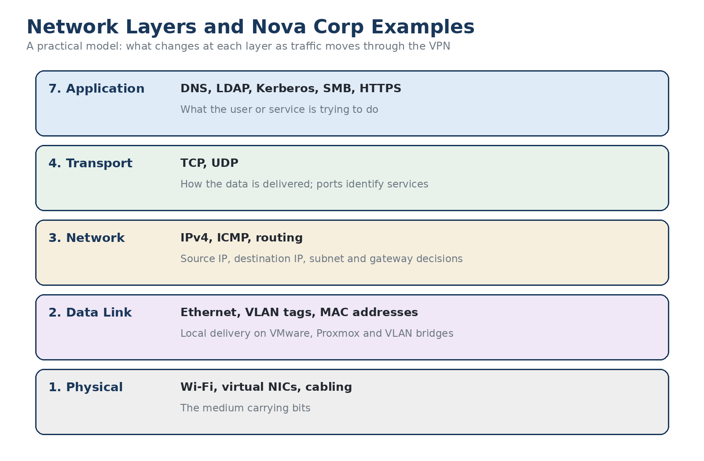
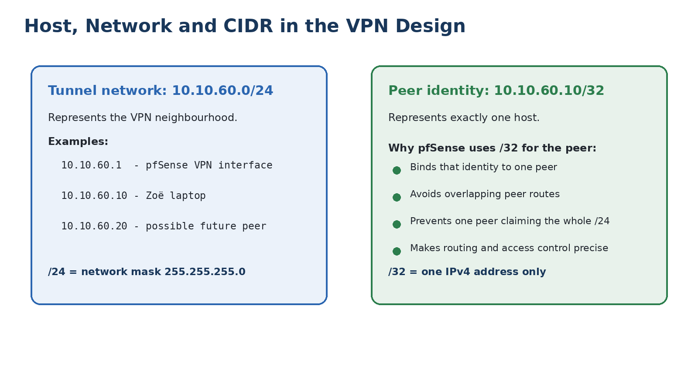
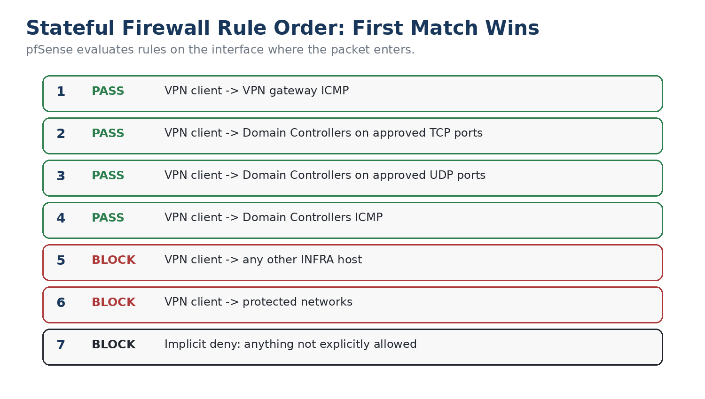
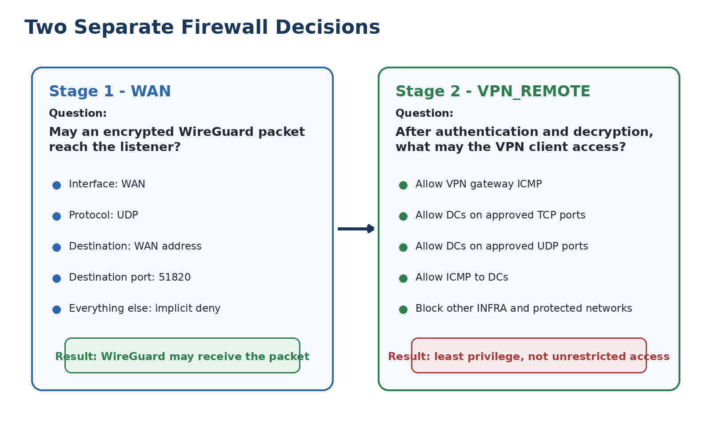
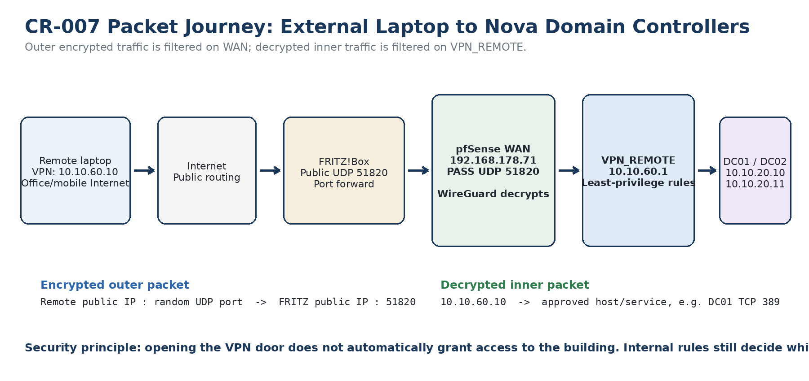
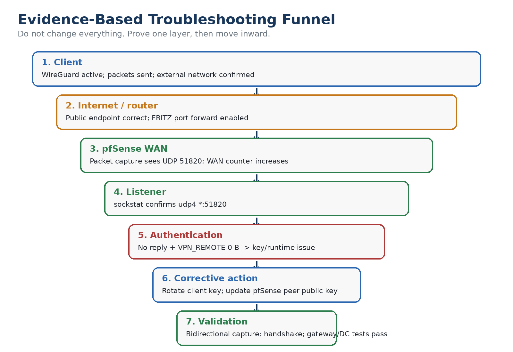

# CR-007 - Remote Access VPN with WireGuard

## Network and Firewall Crash Course, Implementation Record, Validation Report and Incident Post-Mortem

**Project:** Nova Corp Enterprise Infrastructure Lab  
**Engineer:** David Eti  
**Technical reviewer / mentor:** Nova  
**Change type:** Planned security and remote-access change  
**Implementation period:** July 2026  
**Final external validation:** 26 July 2026  
**Final technical status:** **Implemented and passed**  
**Residual items:** External Windows domain join and physical USB-policy validation remain pending because the available external laptop runs Windows Home.

> **Security and publishing notice**  
> This document deliberately excludes all WireGuard private keys. Public keys, exact public IPv4 addresses, MyFRITZ hostnames, email addresses and other externally identifying values are either omitted or replaced with placeholders. Any screenshots added later must be redacted before publication.


# Contents

1. Executive summary
2. Source requirements and project alignment
3. Crash course - network layers, protocols and firewalls
4. Change request
5. Architecture and dependency chain
6. Pre-change baseline and CP-00 checks
7. Risk assessment and rollback
8. Implementation record
9. Validation plan, commands and outcomes
10. Incident report - WireGuard handshake failure
11. Final firewall and access-control assessment
12. Operational troubleshooting runbook
13. Router and IP-address change runbook
14. Monitoring, auditing and maintenance
15. Outstanding and deferred items
16. Final acceptance summary and lessons learned
17. Evidence and screenshot plan
18. Portfolio and LinkedIn angle
19. Appendices - commands, glossary, redaction and closure

> Use the Word Navigation Pane or document headings to jump directly to any section.


# Document control

- **Change ID:** CR-007
- **Title:** Remote Access VPN and External Workstation Integration
- **Primary technology:** WireGuard on pfSense CE
- **Firewall:** `nova-fw01` / pfSense CE 2.8.1
- **Hypervisor:** `nova-prox01` / Proxmox VE nested in VMware Workstation
- **Domain:** `nova.corp`
- **Domain Controllers:** `nova-dc01` (`10.10.20.10`), `nova-dc02` (`10.10.20.11`)
- **VPN subnet:** `10.10.60.0/24`
- **pfSense VPN address:** `10.10.60.1`
- **Remote client address:** `10.10.60.10`
- **WireGuard transport:** UDP `51820`
- **External test client:** Physical Windows laptop using the WireGuard client
- **External test network:** Separate office/mobile network, not the Nova home network
- **Risk level:** Medium, because an incorrect firewall rule or VPN scope could expose management or server networks
- **Approval:** Approved interactively during the Nova Corp change workflow
- **Result:** Passed after resolving a peer public-key misconfiguration


# Executive summary

CR-007 created secure remote access into the Nova Corp lab using WireGuard on pfSense. The work was intentionally treated as an enterprise change rather than a simple “install a VPN” exercise. The change covered architecture review, public and private addressing, double NAT, port forwarding, firewall rule design, split tunnelling, Active Directory service requirements, positive and negative security tests, packet capture, stateful-firewall analysis, troubleshooting and rollback planning.

The final design allows an authorised remote peer to:

- Establish an encrypted WireGuard tunnel from an external network.
- Reach the WireGuard gateway at `10.10.60.1`.
- Resolve `nova.corp` records through the Nova DNS servers.
- Discover both Domain Controllers through Active Directory LDAP SRV records.
- Reach the Domain Controllers only on approved AD-related TCP and UDP services.
- Ping the two approved Domain Controllers for diagnostic purposes.

The same remote peer is blocked from:

- Unapproved hosts in the INFRA network.
- The other protected Nova networks included in the protected-network alias.
- Direct access to pfSense, Proxmox and other management services unless a separate explicit rule is approved.
- Any destination not matched by an allow rule, because pfSense ends with an implicit deny.

The most important technical incident occurred during the first handshake test. UDP handshake-initiation packets reached pfSense WAN and matched the correct WAN rule, but WireGuard sent no reply and the `VPN_REMOTE` rules remained at zero bytes. This proved that routing, the public endpoint, FRITZ!Box port forwarding and the WAN firewall path were working. The fault was therefore isolated to WireGuard peer authentication. Recreating the client key pair and updating the peer public key on pfSense resolved the problem. The follow-up packet capture showed bidirectional encrypted traffic, and all approved DNS, Kerberos, LDAP and SMB tests passed.

The strongest outcome was not merely that the VPN connected. It was that the engineer could explain and prove every layer of the packet path, identify the exact failure boundary, correct one variable and validate both allowed and denied access.


# Source requirements and project alignment

The Nova Corp infrastructure guide contains a later security phase requiring WireGuard on the firewall, a client configuration and proof that remote access is limited by firewall policy. The operational-enhancements guide also requires every significant change to contain a purpose, risk assessment, validation plan, rollback plan and final result.

There is an important scope distinction that must not be hidden:

- The main guide includes a remote-employee ticket whose intended profile can reach the internal application in the DMZ but must not reach Active Directory or management systems.
- CR-007 implemented a different, deliberately approved profile for external workstation and administrative validation. This profile was permitted to reach the Domain Controllers on a restricted list of AD services.

Therefore, CR-007 does **not** close the future DMZ-only employee-access ticket. A future ordinary employee peer should use a separate address, separate peer entry and separate least-privilege firewall policy. Reusing the CR-007 AD-capable policy for every employee would violate the guide’s original business requirement.

CR-007 was also pulled forward because CR-006 had deferred physical USB testing and external workstation integration. The VPN portion is now complete. However, the available external laptop runs Windows Home, which cannot join an Active Directory domain. The physical domain-join and USB-policy acceptance tests remain open until a Windows Pro/Enterprise/Education device is available or the laptop edition is upgraded.


# 1. Crash course - network layers, protocols and firewalls

This section explains the concepts used throughout the change. It is written as a practical reference rather than an exam-focused theory chapter.



**Figure 1 -** A practical layer model showing where Nova Corp protocols and devices operate.

## 1.1 Why layers matter during troubleshooting

A network problem is easier to solve when it is divided into layers. Each layer answers a different question:

- **Physical / virtual media** — **Practical question:** Is there a working path for bits?; **CR-007 example:** Laptop Wi-Fi, VMware virtual NICs, Proxmox bridges
- **Data link** — **Practical question:** Can the device communicate on the local segment?; **CR-007 example:** MAC addresses, VLAN tags, `vmbr0`, `vmbr1`
- **Network** — **Practical question:** Can IP packets be routed to the destination?; **CR-007 example:** `192.168.178.0/24`, `10.10.60.0/24`, default gateways
- **Transport** — **Practical question:** Which delivery protocol and service port are used?; **CR-007 example:** UDP `51820`, TCP `389`, UDP `53`
- **Application** — **Practical question:** Does the intended service actually work?; **CR-007 example:** DNS resolution, LDAP discovery, Kerberos, SMB


A successful ping does not prove LDAP works. A packet appearing on WAN does not prove WireGuard authenticated it. A firewall rule counter increasing does not prove the application returned a response. Each test should prove one layer and no more.

## 1.2 Packet, frame and payload

A **packet** is a unit of IP communication. It contains information such as:

- Source IP address.
- Destination IP address.
- Transport protocol, such as TCP, UDP or ICMP.
- Source and destination ports when the protocol uses ports.
- The payload being carried.

On an Ethernet or virtual Ethernet segment, the IP packet is carried inside a **frame**, which includes local MAC-address information. When a router forwards the packet to a new network, the IP source and destination normally remain relevant end-to-end, but the local frame information changes for the next segment.

WireGuard adds another useful distinction:

- The **outer packet** is encrypted UDP traffic between the remote public endpoint and pfSense UDP `51820`.
- The **inner packet** is the original private traffic, for example `10.10.60.10` to `10.10.20.10` TCP `389`.

The WAN firewall sees the outer packet. After successful authentication and decryption, the `VPN_REMOTE` rules see the inner packet.

## 1.3 Host, network and subnet

A **host** is one specific device or IP address.

Examples:

```text
nova-dc01       10.10.20.10
nova-dc02       10.10.20.11
VPN laptop      10.10.60.10
```

A **network** is a collection of addresses that share a network prefix.

Examples:

```text
INFRA network       10.10.20.0/24
VPN network         10.10.60.0/24
Outer home network  192.168.178.0/24
```

A useful analogy is:

```text
Network = the street
Host    = one house on the street
Port    = one department or door inside the house
Protocol = the agreed delivery method
```



**Figure 2 -** The VPN uses a `/24` tunnel network but a `/32` identity for the individual peer.

## 1.4 CIDR notation: `/24` and `/32`

CIDR notation shows how many leading bits identify the network.

### `/24`

```text
10.10.60.0/24
```

A `/24` uses the subnet mask:

```text
255.255.255.0
```

In the Nova VPN design, this represents the complete VPN subnet. It contains the pfSense VPN interface, the current remote peer and room for future peers.

### `/32`

```text
10.10.60.10/32
```

A `/32` identifies exactly one IPv4 address. On the pfSense peer entry, `10.10.60.10/32` means:

> This public key is permitted to represent exactly the host `10.10.60.10`.

It is not `/24` because granting one peer `10.10.60.0/24` would let that peer claim the route for the entire VPN network and overlap with future peers. Peer `Allowed IPs` serve both as routes and as a cryptographic identity-to-address binding.

The Windows client interface itself used `10.10.60.10/24` because it participates in the complete tunnel subnet. The pfSense peer record used `10.10.60.10/32` because that record describes one remote peer.

## 1.5 Private and public IPv4 addresses

Private IPv4 ranges are intended for internal networks and are not routed directly across the public Internet:

```text
10.0.0.0/8
172.16.0.0/12
192.168.0.0/16
```

Nova uses multiple private networks:

```text
10.10.10.0/24    MGMT
10.10.20.0/24    INFRA
10.10.30.0/24    APP
10.10.40.0/24    CLIENT
10.10.50.0/24    DMZ
10.10.60.0/24    VPN_REMOTE
192.168.178.0/24 Outer FRITZ!Box network
```

The FRITZ!Box has a public Internet address supplied by the ISP. That address was verified by comparing the router’s displayed IPv4 address with a public-IP checking service. The values matched, which showed that the connection was not behind IPv4 carrier-grade NAT at the time of testing.

## 1.6 CGNAT

**Carrier-Grade NAT (CGNAT)** is NAT performed by the ISP. Under CGNAT, multiple customers share an ISP public IPv4 address. A customer router may receive an address from a special or private range instead of a directly reachable public address.

Why it matters:

```text
No CGNAT:
Internet -> customer public IP -> router port forward -> pfSense

CGNAT:
Internet -> ISP NAT -> customer router -> pfSense
```

A normal customer cannot configure the ISP’s upstream NAT. Therefore, inbound port forwarding often fails under CGNAT unless the ISP provides a public address, IPv6 is used appropriately, or an outbound/mesh solution such as Tailscale is selected.

CR-007 verified that the FRITZ!Box’s public IPv4 matched the address seen externally, so direct inbound UDP forwarding was possible.

## 1.7 NAT and double NAT

**Network Address Translation (NAT)** changes address information as traffic crosses a boundary.

Nova’s external path contains two routing/NAT layers:

1. FRITZ!Box between the public Internet and `192.168.178.0/24`.
2. pfSense between `192.168.178.0/24` and the Nova VLANs.

This is often called **double NAT**.

For the inbound WireGuard connection, the FRITZ!Box performs destination NAT:

```text
Before port forwarding:
Source:      <REMOTE_PUBLIC_IP>:<random-port>
Destination: <FRITZ_PUBLIC_IP>:51820

After port forwarding:
Source:      <REMOTE_PUBLIC_IP>:<random-port>
Destination: 192.168.178.71:51820
```

The destination changes to pfSense. The remote source normally remains visible, which is why the pfSense WAN packet capture showed the external public source rather than the FRITZ!Box LAN address.

## 1.8 Port forwarding

A port forward tells the outer router:

> When traffic arrives on this public protocol and port, send it to this internal device and port.

The CR-007 rule was intentionally narrow:

```text
External protocol: UDP
External port:     51820
Internal device:   pfSense / 192.168.178.71
Internal port:     51820
```

It did not expose all ports and did not configure pfSense as an exposed host.

A port forward is not the same as a firewall permission. Both were required:

```text
FRITZ!Box port forward
+ pfSense WAN allow rule
+ WireGuard peer authentication
+ VPN_REMOTE internal allow rule
```

If any one of these controls failed, the complete access path would fail.

## 1.9 Protocols

A **protocol** is an agreed set of rules for communication.

### TCP

TCP is connection-oriented. It establishes a session, tracks ordering and retransmits missing data. Common Nova examples include:

- TCP `53` - DNS when a response is large or a TCP query is required.
- TCP `88` - Kerberos.
- TCP `135` - RPC endpoint mapper.
- TCP `389` - LDAP.
- TCP `445` - SMB, SYSVOL and related Windows domain functions.
- TCP `3268` - Global Catalog.
- TCP `49152-65535` - dynamic RPC range used by modern Windows.

### UDP

UDP is connectionless and lightweight. It has no TCP-style handshake or guaranteed retransmission. Applications that use it handle their own retry and reliability behaviour when needed.

Common Nova examples include:

- UDP `53` - normal DNS queries.
- UDP `88` - Kerberos.
- UDP `123` - NTP time synchronisation.
- UDP `389` - LDAP-related discovery in some workflows.
- UDP `464` - Kerberos password change.
- UDP `51820` - WireGuard transport.

WireGuard uses UDP because it is designed as a lean encrypted tunnel protocol and does not need TCP’s connection machinery. The pfSense listener was configured for UDP `51820`, so a TCP firewall rule on the same number would not match WireGuard traffic.

### ICMP

ICMP carries network-control and diagnostic messages. `ping` uses ICMP echo request and echo reply.

A successful ping proves basic IP reachability and ICMP permission. It does not prove that DNS, LDAP, SMB or another application service is working.

## 1.10 Ports

An IP address identifies a host. A port identifies a service endpoint on that host.

Example:

```text
10.10.20.10:389/TCP
```

means:

```text
Host:       nova-dc01
IP:         10.10.20.10
Protocol:   TCP
Service:    LDAP
Port:       389
```

Source ports are usually temporary high-numbered ports selected by the client. Destination ports normally identify the service. This is why firewall source-port fields were left as `Any` while destination ports were restricted.

## 1.11 DNS and Active Directory discovery

Active Directory depends heavily on DNS. A client does more than resolve a server name. It searches for SRV records that advertise domain services.

The final test queried:

```text
_ldap._tcp.dc._msdcs.nova.corp
```

Both Domain Controllers were returned on LDAP port `389`. This proved that the remote client could reach Nova DNS and discover the domain’s LDAP service locations.

## 1.12 Kerberos, LDAP and SMB

### Kerberos - port 88

Kerberos provides domain authentication. Time accuracy and DNS are important because authentication tickets depend on correct identity, service discovery and acceptable clock skew.

### LDAP - port 389

LDAP is used to query directory information such as users, computers, groups and services.

### SMB - port 445

SMB is used for file sharing and important domain functions. Domain-joined clients retrieve Group Policy and logon-related content from shares such as SYSVOL and NETLOGON.

Passing ports `53`, `88`, `389` and `445` does not by itself prove a Windows Home laptop can join the domain. Windows edition support is a separate operating-system capability.

## 1.13 Routing and default gateways

A host consults its routing table to decide where a packet should go.

- If the destination belongs to a directly connected network, the host sends it directly on that interface.
- If a more specific route exists, the host follows that route.
- Otherwise, it uses the default route/default gateway.

The WireGuard client used split tunnelling. Its peer `AllowedIPs` contained only:

```text
10.10.60.1/32
10.10.20.0/24
```

Therefore:

```text
Nova VPN destinations -> WireGuard adapter
Normal Internet traffic -> office/mobile Wi-Fi gateway
```

The WireGuard interface had no normal default gateway, which was expected. A `0.0.0.0/0` AllowedIPs entry would have created a full tunnel and sent all Internet traffic through Nova, which was not required.

## 1.14 MTU and MSS

**MTU (Maximum Transmission Unit)** is the largest packet size an interface can carry without fragmentation at that point.

The WireGuard tunnel showed an MTU of `1440`. A common physical Ethernet MTU is `1500`, but an encrypted tunnel adds outer IP, UDP and WireGuard headers. Reducing the tunnel MTU leaves space for that overhead.

A simple analogy:

```text
Truck capacity: 1500 units
Tunnel packaging: consumes some space
Inner cargo limit: reduced so the complete package still fits
```

**MSS (Maximum Segment Size)** is a TCP concept describing the maximum TCP payload carried in a segment. MSS clamping can help prevent TCP packets from becoming too large after tunnel encapsulation.

MTU was not changed during the incident because the failure occurred before a handshake and before normal tunneled traffic. Changing MTU would have been an unrelated guess.

## 1.15 Stateful firewalls

pfSense is a stateful firewall. When it allows a flow, it creates a temporary **state** that remembers the conversation and permits matching return traffic.

For TCP, the state tracks a real connection. UDP has no connection handshake, but pfSense still creates a temporary state based on the addresses, ports and protocol.

A state is similar to a security desk recording an authorised visitor:

```text
Visitor is approved -> entry is recorded -> expected reply traffic is permitted
After inactivity -> record expires
```

The pfSense rule page displays current state count and accumulated traffic separately. For example, `0 / 55 KiB` meant the rule had matched approximately 55 KiB historically but had no active state at the exact moment the page was viewed.

## 1.16 Rule direction: the interface where traffic enters

A critical pfSense rule is:

> Filter a packet on the interface through which it enters pfSense.

Examples:

```text
CLIENT host 10.10.40.100 -> pfSense WAN address 192.168.178.71
Packet enters pfSense through CLIENT
Therefore CLIENT rules are evaluated
```

Typing a WAN address in a browser does not automatically mean WAN rules are used. The packet’s entry interface decides the rule set.

For the real external VPN:

```text
Encrypted packet enters pfSense through WAN
-> WAN rules

Decrypted packet appears from the WireGuard assigned interface
-> VPN_REMOTE rules
```

## 1.17 Rule order, first match and implicit deny

pfSense evaluates interface rules from top to bottom. The first matching quick rule decides the result.



**Figure 3 -** The CR-007 rule set allows approved traffic before blocking broader destination groups.

The order matters because the approved Domain Controllers are located inside the broader INFRA subnet. If the rule blocking all INFRA destinations appeared above the Domain Controller allow rules, approved AD traffic would be blocked before it reached the allow rule.

Anything not explicitly passed is blocked by the implicit deny at the end.

## 1.18 “Block private networks” on a private WAN

pfSense initially had **Block private networks** enabled on WAN. This option blocks packets entering WAN when their source is from RFC1918 private space.

That option is normally sensible on an Internet-facing WAN that receives a real public address. Nova’s pfSense WAN is different:

```text
pfSense WAN: 192.168.178.71/24
Gateway:     192.168.178.1
```

It intentionally lives behind the FRITZ!Box in private address space. The option was therefore disabled.

Disabling it did **not** expose the pfSense GUI. Removing a block rule does not create a pass rule. WAN still contained only the narrow UDP `51820` pass rule followed by implicit deny.

The bogon-network block remained enabled.

## 1.19 WAN firewall versus VPN firewall



**Figure 4 -** The WAN rule protects the VPN listener; `VPN_REMOTE` controls post-authentication access.

### WAN rule

Question:

> May the encrypted WireGuard packet reach the listener?

Rule:

```text
PASS IPv4 UDP
Source: any
Destination: WAN address
Destination port: 51820
```

### VPN_REMOTE rules

Question:

> After WireGuard authenticates and decrypts the client, which internal services may it use?

The rule set allowed the gateway and approved Domain Controller services, then blocked unapproved INFRA and protected networks.

Opening the VPN transport port is like allowing a person to approach the secure entrance. WireGuard keys verify the person’s identity. Internal firewall rules still decide which rooms the authenticated person may enter.

## 1.20 Firewall aliases

Aliases improve readability and reduce errors by grouping related addresses or ports under a name.

CR-007 created:

- **`NOVA_DOMAIN_CONTROLLERS`** — **Type:** Hosts; **Content / purpose:** `10.10.20.10`, `10.10.20.11`
- **`NOVA_PROTECTED_NETWORKS`** — **Type:** Networks; **Content / purpose:** MGMT, APP, CLIENT, DMZ, outer home network and other protected ranges
- **`NOVA_AD_TCP_PORTS`** — **Type:** Ports; **Content / purpose:** Approved TCP ports required for the chosen AD-access profile
- **`NOVA_AD_UDP_PORTS`** — **Type:** Ports; **Content / purpose:** Approved UDP ports required for the chosen AD-access profile


The TCP and UDP aliases were separated because a port number does not automatically imply a protocol. A rule using `TCP/UDP` would grant both protocols on every number in the alias and would be broader than required.

## 1.21 Packet capture

Packet capture records packets seen on an interface. It is one of the strongest tools for answering:

- Did the packet reach this interface?
- What source and destination were visible?
- Which protocol and port were used?
- Was traffic one-way or bidirectional?

A WAN capture can see an incoming packet before the firewall decides whether to pass or block it. Therefore, seeing a packet in the capture proves arrival at the interface, not application acceptance.

This distinction was essential during the failed handshake incident.


# 2. Change request

## 2.1 Business reason

Nova Corp needed a secure method for an authorised external workstation to reach selected internal identity services without exposing management interfaces or granting broad access to the server networks.

The business and learning requirements were:

- Validate secure remote access from a physical device outside the nested virtual environment.
- Prepare for future remote administration and external workstation integration.
- Reach both Domain Controllers through Nova DNS and approved AD service ports.
- Use least privilege rather than a broad VPN-to-any rule.
- Preserve the ability to create separate, more restrictive VPN profiles later.
- Produce evidence and a troubleshooting runbook suitable for a real operational team.

## 2.2 Included scope

- Baseline validation of pfSense, Proxmox, VLANs, Domain Controllers and the Windows client.
- WireGuard package installation on pfSense.
- Tunnel and peer configuration.
- Dedicated `VPN_REMOTE` interface and `10.10.60.0/24` network.
- Split-tunnel Windows client configuration.
- pfSense IP and port aliases.
- Least-privilege VPN firewall rules.
- pfSense WAN UDP `51820` rule.
- FRITZ!Box UDP port forwarding.
- Real external-network validation.
- DNS, LDAP SRV, Kerberos, LDAP and SMB connectivity tests.
- Negative access tests.
- Incident diagnosis and key rotation.
- Rollback plan and operating runbook.

## 2.3 Excluded scope

- Full-tunnel Internet routing through Nova.
- Public access to pfSense, Proxmox, RDP, SSH or SMB.
- General employee access to the DMZ application.
- Domain joining the available Windows Home laptop.
- Closing the deferred physical USB GPO validation.
- High availability for pfSense or the FRITZ!Box.
- Central monitoring/alerting for WireGuard peer availability.
- Automatic peer provisioning.

## 2.4 Success criteria

The change would be considered successful only when all of the following were proven:

1. External UDP `51820` reaches pfSense WAN.
2. WireGuard completes an authenticated bidirectional handshake.
3. The remote client receives/uses `10.10.60.10`.
4. `10.10.60.1` is reachable through the tunnel.
5. Both Domain Controllers are reachable where explicitly allowed.
6. Nova DNS resolves both DC host records.
7. LDAP SRV discovery returns both DCs.
8. Representative AD TCP ports succeed on both DCs.
9. An unapproved INFRA destination is blocked.
10. The test succeeds from a genuinely external network.
11. No private key or unrestricted firewall rule is introduced.


# 3. Architecture and dependency chain



**Figure 5 -** Complete remote packet flow from an external laptop to the approved Domain Controllers.

## 3.1 Outer network

- **FRITZ!Box LAN gateway:** `192.168.178.1`
- **Proxmox management:** `192.168.178.26`
- **pfSense WAN:** `192.168.178.71`
- **Public endpoint:** `<FRITZ_PUBLIC_IP>` or `<MYFRITZ_HOSTNAME>`
- **Port forward:** UDP `51820` to `192.168.178.71:51820`


## 3.2 Nova networks

- **MGMT** — **Subnet:** `10.10.10.0/24`; **Gateway / purpose:** Management systems
- **INFRA** — **Subnet:** `10.10.20.0/24`; **Gateway / purpose:** Domain Controllers and infrastructure servers
- **APP** — **Subnet:** `10.10.30.0/24`; **Gateway / purpose:** Application servers
- **CLIENT** — **Subnet:** `10.10.40.0/24`; **Gateway / purpose:** Domain workstations
- **DMZ** — **Subnet:** `10.10.50.0/24`; **Gateway / purpose:** Externally facing/reverse-proxy services
- **VPN_REMOTE** — **Subnet:** `10.10.60.0/24`; **Gateway / purpose:** Remote WireGuard peers
- **Legacy pfSense LAN** — **Subnet:** `10.99.99.0/24`; **Gateway / purpose:** Existing local interface retained during this change


## 3.3 WireGuard addressing

```text
Tunnel interface on pfSense: 10.10.60.1/24
Remote client interface:      10.10.60.10/24
pfSense peer Allowed IP:      10.10.60.10/32
```

## 3.4 Split-tunnel route selection

The Windows peer configuration routed only:

```text
10.10.60.1/32
10.10.20.0/24
```

through WireGuard. The laptop’s normal Internet route remained on the external Wi-Fi/office network.

## 3.5 DNS design

The client used:

```text
10.10.20.10
10.10.20.11
nova.corp
```

as its WireGuard DNS configuration. This enabled internal host-name resolution and AD service discovery only when the tunnel was active and the relevant firewall rules permitted DNS.


# 4. Pre-change baseline and CP-00 checks

The baseline phase existed to prevent CR-007 from being blamed for unrelated faults. The network, domain and workstation were validated before VPN configuration.

## 4.1 pfSense interfaces

Observed pfSense interface design:

```text
WAN     vtnet0      DHCP / 192.168.178.71/24
LAN     vtnet1      10.99.99.1/24
MGMT    vtnet1.10   10.10.10.1/24
INFRA   vtnet1.20   10.10.20.1/24
APP     vtnet1.30   10.10.30.1/24
CLIENT  vtnet1.40   10.10.40.1/24
DMZ     vtnet1.50   10.10.50.1/24
```

The WAN default gateway was explicitly set to the DHCP gateway:

```text
WAN_DHCP -> 192.168.178.1
```

## 4.2 Proxmox networking

The Proxmox host used:

```text
vmbr0  192.168.178.26/24  gateway 192.168.178.1
vmbr1  manual, VLAN-aware, bridge-vids 2-4094
```

`vmbr0` connected the nested Proxmox host to the outer FRITZ!Box network. `vmbr1` carried the internal VLAN trunk used by pfSense and Nova virtual machines.

The pfSense VM had:

```text
net0 -> vmbr0   WAN
net1 -> vmbr1   VLAN trunk
```

## 4.3 Proxmox reachability checks

From the Windows host:

```powershell
ping 192.168.178.26
arp -a | findstr 192.168.178.26
```

Purpose:

- Prove that Proxmox remained reachable on its expected static address.
- Confirm that an ARP entry existed even though the FRITZ!Box device list did not present Proxmox clearly.

Observed outcome:

```text
4 replies, 0% loss, sub-millisecond latency
ARP entry present
```

On Proxmox:

```bash
ip -br address
ip route
cat /sys/class/net/nic0/address
```

Observed:

```text
vmbr0 UP 192.168.178.26/24
default via 192.168.178.1 dev vmbr0
```

The ARP MAC visible from Windows differed from the Proxmox virtual NIC MAC, which was attributed to the nested VMware bridge over Wi-Fi and how the outer network presents virtual MAC identities. Connectivity and routing were treated as the authoritative evidence.

## 4.4 Domain Controller baseline

On the Domain Controllers and existing Nova client, the following were checked:

```powershell
Get-NetIPConfiguration
Get-DnsClientServerAddress -AddressFamily IPv4
Get-ADDomain | Select-Object DNSRoot, NetBIOSName, PDCEmulator
w32tm /query /status
```

Observed baseline:

- DC addresses were `10.10.20.10` and `10.10.20.11`.
- Domain DNS was available on both DCs.
- The domain was `nova.corp`.
- Time synchronisation referenced the domain hierarchy.

## 4.5 Existing client and Group Policy baseline

The Nova workstation showed:

```text
NOVA-CLIENT
10.10.40.100/24
gateway 10.10.40.1
DNS 10.10.20.10, 10.10.20.11
```

Secure-channel and DC discovery tests had already passed:

```powershell
nltest /dsgetdc:nova.corp
Test-ComputerSecureChannel -Verbose
w32tm /query /status
gpresult /r /scope computer
```

The workstation baseline GPO and Default Domain Policy applied successfully.

## 4.6 Storage and rollback snapshot

Before structural VPN changes, a Proxmox snapshot was created for pfSense. Proxmox warned that the sum of allocated thin volumes exceeded the physical thin-pool size, but the snapshot task completed successfully.

The snapshot was retained as the first rollback point for the change.


# 5. Risk assessment

- **Broad VPN allow rule** — **Potential impact:** Remote peer can access management and unrelated servers; **Mitigation:** Use named aliases and explicit allow rules, followed by block rules and implicit deny
- **Incorrect rule order** — **Potential impact:** Approved AD traffic blocked or protected network opened; **Mitigation:** Place specific allow rules above broad blocks; validate positive and negative cases
- **WAN GUI exposure** — **Potential impact:** pfSense management interface reachable from Internet; **Mitigation:** Permit only UDP `51820`; do not create TCP `80/443` WAN rules
- **Port-forward mistake** — **Potential impact:** Traffic sent to wrong device or service; **Mitigation:** Target pfSense `192.168.178.71`, UDP only, same external/internal port
- **Public-key mismatch** — **Potential impact:** Silent handshake failure; **Mitigation:** Cross-check peer keys; use packet capture and counters; rotate client key if uncertain
- **Private key disclosure** — **Potential impact:** Unauthorised device could impersonate peer; **Mitigation:** Never publish private keys; rotate the exposed client key pair
- **pfSense WAN DHCP change** — **Potential impact:** FRITZ!Box forward stops working; **Mitigation:** Track address, investigate reservation/static strategy, verify after router/DHCP changes
- **Dynamic public IP change** — **Potential impact:** Client endpoint becomes stale; **Mitigation:** Prefer MyFRITZ/DynDNS hostname over a hard-coded address
- **Windows Home limitation** — **Potential impact:** Cannot join `nova.corp` or complete GPO/USB tests; **Mitigation:** Use Windows Pro/Enterprise/Education or another physical device later
- **Excessive port alias** — **Potential impact:** More AD services exposed than necessary; **Mitigation:** Review port list, separate TCP/UDP, scope destinations to DC host alias
- **Firewall logging volume** — **Potential impact:** Disk/log noise; **Mitigation:** Enable detailed logging during validation, then retain only necessary operational logging
- **Router replacement** — **Potential impact:** Outer subnet, gateway and port forward change; **Mitigation:** Follow documented router-migration runbook


# 6. Rollback plan

Global change rule: restore service first, preserve evidence where possible, and investigate after the environment is stable.

## 6.1 Immediate rollback sequence

If the VPN change caused an outage or unexpected access:

1. Deactivate the remote client tunnel.
2. Disable the FRITZ!Box `Nova WireGuard` port-sharing rule.
3. Disable the pfSense WAN UDP `51820` pass rule.
4. Disable the WireGuard service or the affected peer.
5. Disable the `VPN_REMOTE` interface rules if an internal access-control error exists.
6. Confirm normal Nova VLAN routing and existing services still work.
7. Restore the pfSense pre-change snapshot only if configuration-level rollback is insufficient.
8. Document the fault and corrected design before re-enabling access.

## 6.2 Peer-specific rollback

To revoke only Zoë’s laptop without affecting the tunnel service:

1. Disable or delete the peer entry associated with `10.10.60.10/32`.
2. Apply WireGuard changes.
3. Confirm `wg show` no longer lists the peer.
4. Preserve the peer record in the change log for audit purposes.
5. Rotate keys before recreating the peer.

## 6.3 Firewall rollback

If approved traffic is blocked or excessive traffic is allowed:

1. Capture the current rules and counters.
2. Disable the smallest affected rule rather than disabling the complete firewall.
3. Flush only the related states if necessary.
4. Validate one approved and one denied test.
5. Correct the rule or alias offline, then re-enable under controlled testing.

## 6.4 Router/port-forward rollback

Remove only the UDP `51820` sharing entry. Do not expose the complete pfSense host and do not enable automatic independent port sharing as a workaround.


# 7. Implementation record

## CP-01 - External addressing and public reachability

### Objective

Confirm whether direct inbound WireGuard was possible and understand the relationship between the FRITZ!Box public address, the outer private LAN and the pfSense WAN.

### Checks performed

- Opened the FRITZ!Box administration interface at `192.168.178.1`.
- Identified the router public IPv4 address.
- Compared it with a public-IP checking service.
- Confirmed the values matched.

### Conclusion

The router had a directly reachable public IPv4 address at the time of testing. CGNAT was not blocking inbound port forwarding.

## CP-02 - pfSense package installation

Navigation:

```text
System -> Package Manager -> Available Packages
```

The WireGuard package was installed successfully. The package added the WireGuard menu and service integration.

Validation:

```text
VPN -> WireGuard
System -> Package Manager -> Installed Packages
```

Result:

```text
WireGuard package present
VPN -> WireGuard menu present
```

## CP-03 - Tunnel creation

The pfSense tunnel was created with:

```text
Name / description: NOVA-REMOTE-ACCESS
Listen port:        51820
Tunnel address:     10.10.60.1/24
```

A new key pair was generated by pfSense. The private key remained hidden and was never required on the client.

Runtime validation:

```bash
wg show
```

Expected:

```text
interface: tun_wg0
listening port: 51820
```

Observed:

```text
interface present
listening port 51820
```

## CP-04 - Assigned VPN interface

The WireGuard tunnel was assigned as a pfSense interface and named:

```text
VPN_REMOTE
```

The interface address was:

```text
10.10.60.1/24
```

Validation commands:

```bash
ifconfig tun_wg0
netstat -rn4 | grep 10.10.60
```

Observed:

```text
tun_wg0 UP/RUNNING
inet 10.10.60.1 netmask /24
mtu 1440
route 10.10.60.0/24 via tun_wg0
```

## CP-05 - Remote peer configuration

The pfSense peer represented one remote laptop:

```text
Description:      Zoë laptop remote
Dynamic endpoint: Enabled
Public key:       <CLIENT_PUBLIC_KEY_REDACTED>
Allowed IP:       10.10.60.10/32
Pre-shared key:   Not used
```

`Dynamic endpoint` was correct because the server does not know the mobile/office public source address in advance. pfSense learns it when the authenticated client initiates a connection.

## CP-06 - Windows WireGuard client

The client used a split-tunnel configuration conceptually equivalent to:

```ini
[Interface]
PrivateKey = <CLIENT_PRIVATE_KEY_REDACTED>
Address = 10.10.60.10/24
DNS = 10.10.20.10, 10.10.20.11, nova.corp

[Peer]
PublicKey = <PFSENSE_PUBLIC_KEY_REDACTED>
AllowedIPs = 10.10.60.1/32, 10.10.20.0/24
Endpoint = <PUBLIC_ENDPOINT_REDACTED>:51820
```

Important design choices:

- The client private key remained on the client.
- The pfSense public key was placed under the client’s `[Peer]` section.
- The client public key was placed in the pfSense peer entry.
- `AllowedIPs` did not contain `0.0.0.0/0`, so the design remained split tunnel.
- `PersistentKeepalive` was not needed to solve the initial failure because the client was already sending packets every few seconds and they reached pfSense.

## CP-07 - Firewall aliases

### IP aliases

```text
NOVA_DOMAIN_CONTROLLERS
- 10.10.20.10
- 10.10.20.11
```

```text
NOVA_PROTECTED_NETWORKS
- protected Nova networks that the VPN must not reach by default
- the outer home network
```

### Port aliases

```text
NOVA_AD_TCP_PORTS
- 53
- 88
- 135
- 389
- 445
- 464
- 3268
- 49152:65535
```

```text
NOVA_AD_UDP_PORTS
- 53
- 88
- 123
- 389
- 464
```

The exact alias lists should be reviewed periodically. The dynamic RPC range is broad but was included to support Windows domain operations for this AD-capable administrative/external-workstation profile. It must not automatically be reused for an ordinary employee profile.

## CP-08 - VPN_REMOTE firewall policy

The final rule order was:

- **1** — **Decision:** Pass; **Match:** ICMP from `VPN_REMOTE subnets` to `VPN_REMOTE address`; **Reason:** Permit gateway diagnostics
- **2** — **Decision:** Pass; **Match:** TCP from VPN to `NOVA_DOMAIN_CONTROLLERS` on `NOVA_AD_TCP_PORTS`; **Reason:** Permit approved AD TCP services
- **3** — **Decision:** Pass; **Match:** UDP from VPN to `NOVA_DOMAIN_CONTROLLERS` on `NOVA_AD_UDP_PORTS`; **Reason:** Permit approved AD UDP services
- **4** — **Decision:** Pass; **Match:** ICMP from VPN to `NOVA_DOMAIN_CONTROLLERS`; **Reason:** Permit DC diagnostics
- **5** — **Decision:** Block; **Match:** Any IPv4 from VPN to `INFRA subnets`; **Reason:** Block unapproved INFRA hosts
- **6** — **Decision:** Block; **Match:** Any IPv4 from VPN to `NOVA_PROTECTED_NETWORKS`; **Reason:** Block other protected networks
- **7** — **Decision:** Block; **Match:** Any unmatched traffic; **Reason:** Implicit default deny


The UDP rule was initially configured as `TCP/UDP` and corrected to UDP-only. This correction enforced least privilege and kept protocol intent clear.

The general `WireGuard` group tab remained empty. The assigned `VPN_REMOTE` interface contained the deliberate policy. No broad `WireGuard -> any` rule was added.

## CP-09 - WAN firewall rule

A single WAN pass rule was created:

```text
Action:           Pass
Interface:        WAN
Address family:   IPv4
Protocol:         UDP
Source:           Any
Source port:      Any
Destination:      WAN address
Destination port: 51820
Description:      allow inbound WireGuard UDP 51820
Logging:          Enabled during validation
```

Validation:

```bash
pfctl -sr | grep 51820
```

Observed compiled rule, interpreted:

```text
pass in quick on vtnet0
reply-to (vtnet0 192.168.178.1)
inet proto udp
from any
to 192.168.178.71 port = 51820
keep state
```

Meaning:

- **`pass`:** Permit matching traffic
- **`in`:** Packet enters pfSense
- **`quick`:** Stop after this rule matches
- **`on vtnet0`:** Apply on WAN
- **`reply-to`:** Return replies through the WAN gateway
- **`inet`:** IPv4
- **`proto udp`:** UDP only
- **`from any`:** Mobile/office source may change
- **`to 192.168.178.71`:** Destination must be pfSense WAN
- **`port = 51820`:** Destination must be the WireGuard listener
- **`keep state`:** Track and permit related replies


## CP-10 - WAN private-network correction

The WAN was behind the FRITZ!Box and intentionally used `192.168.178.71`. The automatic `Block private networks` option was disabled because the WAN itself resides in private address space.

The bogon block remained enabled.

Security remained intact because:

```text
No GUI WAN pass rule existed
No SSH WAN pass rule existed
No RDP WAN pass rule existed
Only UDP 51820 was explicitly permitted
Everything else remained implicitly denied
```

## CP-11 - FRITZ!Box port sharing

The FRITZ!Box device list showed:

```text
Device: pfSense
IPv4:   192.168.178.71
MAC:    <PFSENSE_WAN_MAC_REDACTED>
```

The device-edit page returned HTTP 404, but the port-sharing workflow still worked.

The completed rule showed:

```text
Sharing:                 Nova WireGuard
Protocol:                UDP
External IPv4 port:      51820
Device/internal port:    51820
Target:                  pfSense / 192.168.178.71
Independent port sharing: Disabled
```

The FRITZ!Box security diagnostics later confirmed UDP IPv4 port `51820` was shared to pfSense.

## CP-12 - External test preparation

The laptop was removed from the home FRITZ!Box network and connected to a separate external network.

Observed addressing during external testing:

```text
WireGuard adapter: 10.10.60.10/24
External Wi-Fi:    172.20.10.9/28
External gateway:  172.20.10.1
```

This proved the test used a separate access network. A later packet capture showed an external public source different from the FRITZ!Box public address, proving the final test was not NAT reflection/hairpin traffic.


# 8. Validation plan, commands and outcomes

## 8.1 Command matrix

- **VAL-001** — **Test:** `wg show` runtime configuration; **Observed result:** Tunnel, UDP 51820 and peer present; **Status:** Passed
- **VAL-002** — **Test:** `ifconfig tun_wg0`; **Observed result:** `10.10.60.1/24`, interface up, MTU 1440; **Status:** Passed
- **VAL-003** — **Test:** VPN route; **Observed result:** `10.10.60.0/24` through `tun_wg0`; **Status:** Passed
- **VAL-004** — **Test:** Loaded WAN rule; **Observed result:** UDP pass to WAN address 51820; **Status:** Passed
- **VAL-005** — **Test:** IPv4 UDP listener; **Observed result:** `udp4 *:51820`; **Status:** Passed
- **VAL-006** — **Test:** Initial WAN capture; **Observed result:** Repeated incoming 148-byte initiations; **Status:** Passed
- **VAL-007** — **Test:** WAN counters; **Observed result:** 319 packets, 56,144 bytes, 8 state creations; **Status:** Passed
- **VAL-008** — **Test:** VPN rule counters; **Observed result:** Zero before key fix; increased after correction; **Status:** Passed after fix
- **VAL-009** — **Test:** VPN gateway ping; **Observed result:** 4/4 replies; **Status:** Passed
- **VAL-010** — **Test:** DC01 ping; **Observed result:** 4/4 replies; **Status:** Passed
- **VAL-011** — **Test:** DC02 ping; **Observed result:** 4/4 replies; **Status:** Passed
- **VAL-012** — **Test:** Negative INFRA ping; **Observed result:** Timed out; block counter increased; **Status:** Passed
- **VAL-013** — **Test:** DC01 DNS A record; **Observed result:** `10.10.20.10`; **Status:** Passed
- **VAL-014** — **Test:** DC02 DNS A record; **Observed result:** `10.10.20.11`; **Status:** Passed
- **VAL-015** — **Test:** LDAP SRV query; **Observed result:** Both DCs advertised on port 389; **Status:** Passed
- **VAL-016** — **Test:** TCP 53 to both DCs; **Observed result:** `TcpTestSucceeded: True`; **Status:** Passed
- **VAL-017** — **Test:** TCP 88 to both DCs; **Observed result:** `TcpTestSucceeded: True`; **Status:** Passed
- **VAL-018** — **Test:** TCP 389 to both DCs; **Observed result:** `TcpTestSucceeded: True`; **Status:** Passed
- **VAL-019** — **Test:** TCP 445 to both DCs; **Observed result:** `TcpTestSucceeded: True`; **Status:** Passed
- **VAL-020** — **Test:** True offsite capture; **Observed result:** Different public source and bidirectional UDP; **Status:** Passed


## 8.2 `wg show`

Purpose:

- Confirm that WireGuard loaded the tunnel and peer into the running kernel/service configuration.
- Distinguish a saved GUI configuration from a live runtime configuration.
- Inspect the latest handshake and byte-transfer counters after connection.

Initial failed state:

```text
interface: tun_wg0
listening port: 51820
peer: <CLIENT_PUBLIC_KEY_REDACTED>
allowed ips: 10.10.60.10/32
```

Missing fields:

```text
endpoint
latest handshake
transfer
```

Interpretation:

The peer existed, but no authenticated handshake had completed.

Final successful state was supported by bidirectional packet capture, successful tunnel gateway access and increasing `VPN_REMOTE` counters.

## 8.3 WAN packet capture

Capture filter:

```text
Interface: WAN / vtnet0
Protocol: UDP
Port: 51820
```

Initial output showed repeated packets equivalent to:

```text
<REMOTE_PUBLIC_IP>:<random-port> > 192.168.178.71:51820 UDP length 148
```

Why this mattered:

- 148-byte repeated initiations were consistent with WireGuard handshake attempts.
- The public endpoint and FRITZ!Box forward were working.
- The packet reached pfSense WAN.
- No replies meant the problem was after arrival.

After the key correction, the capture showed both directions:

```text
<REMOTE_PUBLIC_IP>:<random-port> > 192.168.178.71:51820
192.168.178.71:51820 > <REMOTE_PUBLIC_IP>:<random-port>
```

This proved pfSense and the remote client were exchanging encrypted WireGuard traffic.

## 8.4 Firewall counter interpretation

During the incident, the WAN rule showed accumulated traffic while the VPN rules showed zero bytes.

Observed detailed WAN counters included:

```text
Packets:         319
Bytes:           56,144
State creations: 8
```

At the same time:

```text
VPN_REMOTE rules: 0 B
```

Interpretation:

```text
Encrypted packets reached and passed WAN
but
WireGuard did not authenticate/decrypt them
therefore
no inner traffic entered VPN_REMOTE
```

After key correction:

- The WAN rule showed an active state and increasing KiB.
- `VPN_REMOTE` ICMP, TCP and UDP rules showed byte/state counters.
- The INFRA block rule recorded the deliberate negative ping.

This was the strongest evidence that the failure boundary moved from the WAN transport layer to the WireGuard authentication layer.

## 8.5 Gateway and host ping tests

### VPN gateway

```cmd
ping 10.10.60.1
```

Purpose:

- Prove authenticated tunnel traffic reached the assigned `VPN_REMOTE` interface.
- Validate the first ICMP rule.

Outcome:

```text
4 sent, 4 received, 0% loss
```

### Approved Domain Controllers

```cmd
ping 10.10.20.10
ping 10.10.20.11
```

Purpose:

- Confirm routing through pfSense to INFRA.
- Confirm the DC-specific ICMP rule.
- Confirm return traffic through the stateful firewall.

Outcome:

```text
Both hosts replied
```

### Negative INFRA test

```cmd
ping 10.10.20.1
```

Purpose:

- Prove the VPN was not broadly trusted.
- Confirm the “block unapproved INFRA hosts” rule.

Outcome:

```text
100% packet loss
Block-rule byte counter increased
```

## 8.6 DNS host records

Commands:

```powershell
Resolve-DnsName nova-dc01.nova.corp
Resolve-DnsName nova-dc02.nova.corp
```

Expected:

```text
nova-dc01 -> 10.10.20.10
nova-dc02 -> 10.10.20.11
```

Observed:

```text
Both A records returned correctly with TTL 3600
```

Why this test was required:

An IP ping can succeed even when DNS is broken. Active Directory clients rely on DNS names and service records, so IP-only validation was insufficient.

## 8.7 LDAP SRV discovery

Command:

```powershell
Resolve-DnsName -Type SRV _ldap._tcp.dc._msdcs.nova.corp
```

Expected:

- Both Domain Controllers advertised.
- Service port `389`.
- Additional A records for both hosts.

Observed:

```text
nova-dc01.nova.corp -> 10.10.20.10, LDAP 389
nova-dc02.nova.corp -> 10.10.20.11, LDAP 389
```

Why this test was stronger than a normal lookup:

It proved that the remote client could discover domain services the same way a Windows domain workflow would, rather than merely resolving manually chosen names.

## 8.8 Representative TCP service tests

Commands used for each Domain Controller:

```powershell
Test-NetConnection 10.10.20.10 -Port 53
Test-NetConnection 10.10.20.10 -Port 88
Test-NetConnection 10.10.20.10 -Port 389
Test-NetConnection 10.10.20.10 -Port 445

Test-NetConnection 10.10.20.11 -Port 53
Test-NetConnection 10.10.20.11 -Port 88
Test-NetConnection 10.10.20.11 -Port 389
Test-NetConnection 10.10.20.11 -Port 445
```

Observed for every test:

```text
InterfaceAlias:   novazoe
SourceAddress:    10.10.60.10
TcpTestSucceeded: True
```

Why the interface and source fields mattered:

They proved the tests used the WireGuard interface and VPN address instead of accidentally using a local route.

## 8.9 True offsite test

The final validation was repeated from a separate office network.

Evidence:

- External Wi-Fi address remained outside the Nova networks.
- WAN packet capture showed a remote public source different from the FRITZ!Box public address.
- Traffic was bidirectional.
- `10.10.20.11` was reachable.

Conclusion:

The test was a true Internet path and not NAT reflection from inside the home network.


# 9. Incident report - WireGuard handshake failure

## 9.1 Incident record

- **Incident ID:** INC-CR007-001
- **Title:** WireGuard handshake packets arrive at WAN but receive no response
- **Severity:** SEV-3 / change-validation blocker in a non-production lab
- **Date:** 25-26 July 2026
- **Impact:** Remote client could not establish the VPN; CR-007 validation blocked
- **User impact:** No production users; external test laptop could not reach Nova
- **Detection:** Windows client showed bytes sent and zero bytes received; `wg show` had no handshake
- **Root cause:** Client peer public-key configuration was incorrect, stale or not loaded as intended
- **Resolution:** Recreated client key pair and updated the pfSense peer public key
- **Final status:** Resolved and fully validated


## 9.2 Symptoms

Windows WireGuard showed:

```text
Status: Active
Bytes sent: increasing
Bytes received: 0
```

The word `Active` only meant the Windows interface was enabled. It did not prove a successful handshake.

Tests failed:

```text
ping 10.10.60.1 -> timeout
ping 10.10.20.10/11 -> timeout
```

pfSense `wg show` contained the configured peer but no:

```text
endpoint
latest handshake
transfer
```

## 9.3 Initial hypotheses

Possible causes were reduced to:

1. Laptop was not truly external.
2. Public endpoint was wrong or had changed.
3. FRITZ!Box port forwarding was incorrect.
4. pfSense WAN firewall blocked UDP `51820`.
5. WireGuard listener was not running.
6. Peer public keys or pre-shared-key settings did not match.
7. Return routing failed.
8. Internal VPN firewall blocked decrypted traffic.

The troubleshooting process avoided changing multiple variables at once.

## 9.4 Investigation timeline

### Step 1 - Confirm external client path

The laptop received an external Wi-Fi address and gateway outside Nova. The phone/home Wi-Fi ambiguity was removed by using a real separate network.

Result: client path confirmed.

### Step 2 - Confirm packet arrival at pfSense WAN

A WAN packet capture filtered on UDP `51820` showed repeated incoming 148-byte packets every few seconds.

Result:

```text
Endpoint correct enough to reach the router
FRITZ!Box forward working
Packet reaches pfSense WAN
```

### Step 3 - Confirm WAN firewall match

`pfctl -vvsr` showed the UDP `51820` pass rule had matched hundreds of packets and created states.

Result:

```text
WAN firewall was not the blocker
```

### Step 4 - Confirm listener

Command:

```bash
sockstat -4 -l | grep 51820
```

Output:

```text
udp4 *:51820
```

Result:

```text
A live IPv4 UDP listener existed
```

### Step 5 - Compare WAN and VPN_REMOTE counters

WAN counter:

```text
Traffic increasing
```

VPN_REMOTE counters:

```text
0 B
```

Result:

```text
The encrypted packet reached WireGuard,
but no authenticated packet was decrypted into VPN_REMOTE.
```

This eliminated internal firewall rules, DNS, routing to the Domain Controllers and MTU as the immediate cause.

### Step 6 - Focus on peer authentication

The screenshots appeared visually consistent, but WireGuard intentionally gives no error response to an unauthenticated peer. A one-character error, stale copied value or incorrectly loaded peer public key can produce complete silence.

The client private key had also appeared in a screenshot, so rotation was required regardless.

### Step 7 - Correct one variable

Actions:

1. Deleted/recreated the client tunnel and generated a new client key pair.
2. Copied the new client public key.
3. Replaced the public key in the pfSense peer.
4. Saved and applied the WireGuard configuration.
5. Repeated the packet capture and tests.

### Step 8 - Observe recovery

The new capture showed traffic in both directions. The WAN rule gained an active state, `VPN_REMOTE` counters increased, the VPN gateway replied and approved Domain Controller tests passed.

## 9.5 Root-cause statement

The confirmed corrective action was replacement of the client peer key. The exact original character-level defect was not preserved, so the root cause is documented conservatively as:

> The original remote peer public-key configuration was incorrect, stale or not loaded as intended. This prevented WireGuard from authenticating the client. Recreating the client key pair and updating the peer public key on pfSense restored the handshake.

The document does not claim a specific mistyped character because no direct evidence proves which character or storage state was wrong.

## 9.6 Why WireGuard stayed silent

WireGuard does not provide a friendly “wrong key” response to an unauthenticated packet. Silence reduces information exposed to unauthorised senders. Operationally, this means the engineer must infer the failure layer through:

- Packet arrival.
- Firewall counters.
- Listener state.
- Handshake fields.
- Decrypted-interface counters.

## 9.7 Five-whys analysis

1. **Why could the laptop not ping the VPN gateway?**  
   Because no authenticated WireGuard tunnel existed.

2. **Why was there no authenticated tunnel?**  
   Because pfSense did not accept the peer’s handshake.

3. **Why did pfSense not accept it even though packets arrived?**  
   The configured client public-key identity was incorrect, stale or not loaded as intended.

4. **Why was this not immediately obvious?**  
   WireGuard silently discards unauthenticated handshakes and the GUI showed a configured peer without proving that the key pair was valid end to end.

5. **Why did the troubleshooting succeed without weakening security?**  
   Each layer was tested separately, and only the peer key was changed after NAT, firewall, listener and routing evidence had passed.

## 9.8 Preventive actions

- Never type long keys manually; use copy/paste from the exact peer.
- Verify keys crosswise:

```text
Client interface public key = pfSense peer public key
pfSense tunnel public key = client [Peer] public key
```

- Name peers clearly and record the intended VPN address.
- Run `wg show` after every peer update.
- Use a controlled first-handshake test before creating broader access rules.
- Rotate any key whose private component appears in a screenshot or ticket.
- Store redacted evidence, never raw private keys.
- Do not add `allow any`, alter MTU or change unrelated NAT settings before the evidence points to those layers.



**Figure 6 -** Evidence reduced the failure domain from the complete Internet path to one peer identity.


# 10. Final firewall and access-control assessment

## 10.1 Access matrix

- **VPN peer `10.10.60.10`** — **Path / service:** VPN gateway `10.10.60.1`, ICMP; **Result:** Allow; **Reason:** Tunnel diagnostics
- **VPN peer** — **Path / service:** DC01/DC02 on approved TCP AD ports; **Result:** Allow; **Reason:** Domain and DNS services
- **VPN peer** — **Path / service:** DC01/DC02 on approved UDP AD ports; **Result:** Allow; **Reason:** DNS, Kerberos, NTP and related services
- **VPN peer** — **Path / service:** DC01/DC02, ICMP; **Result:** Allow; **Reason:** Diagnostic reachability
- **VPN peer** — **Path / service:** Any other INFRA host; **Result:** Block; **Reason:** Least privilege
- **VPN peer** — **Path / service:** MGMT, APP, CLIENT, DMZ and outer protected networks; **Result:** Block; **Reason:** Prevent lateral movement and management access
- **Internet** — **Path / service:** pfSense WAN UDP `51820`; **Result:** Allow; **Reason:** WireGuard transport only
- **Internet** — **Path / service:** pfSense WAN GUI/SSH/RDP/other; **Result:** Block; **Reason:** No business requirement


## 10.2 Why the design is safer than “VPN equals trusted LAN”

A common weak design grants a VPN subnet unrestricted internal access. CR-007 treated the VPN as an untrusted entry zone whose users require explicit permissions.

The remote peer could authenticate successfully and still remain constrained. This protects against:

- A stolen or compromised remote laptop.
- Incorrect peer assignment.
- Malware on an authorised endpoint.
- Accidental access to management services.
- Future peers receiving more access than their role requires.

## 10.3 Remaining security limitations

- WireGuard peer authentication is device-key based; user MFA was not added in this CR.
- The available laptop is shared/personal and not a managed corporate endpoint.
- No endpoint-compliance or posture check exists.
- The public UDP port is intentionally reachable, though unauthenticated peers should receive no useful response.
- Central alerting for new peers, repeated failed handshakes or unusual traffic is not yet implemented.
- The AD-capable rule set should be limited to administrative or domain-integration use and must not be the default employee profile.


# 11. Operational runbook - remote VPN cannot connect

## 11.1 Alert / symptom

Remote user reports one or more of:

- WireGuard appears active but receives zero bytes.
- `ping 10.10.60.1` times out.
- Internal DNS names fail.
- Domain Controller ports fail.
- Connection worked previously but stopped after router or key changes.

## 11.2 Severity guidance

- **SEV-1:** All critical remote administrators locked out during a major outage with no alternative access
- **SEV-2:** Multiple business users cannot access required remote services
- **SEV-3:** One peer or a planned-change validation is blocked
- **SEV-4:** Non-urgent performance or documentation issue


## 11.3 Layered procedure

### Layer A - Client state

Check:

```powershell
ipconfig
route print
```

Confirm:

- WireGuard interface exists.
- Correct VPN address is present.
- External Internet works.
- The client is not accidentally on the home Nova network when an offsite test is required.
- Endpoint and port are correct.

Do not interpret `Active` as proof of a handshake.

### Layer B - Public endpoint and router

Confirm:

- FRITZ!Box public address or MyFRITZ name is current.
- No CGNAT change occurred.
- Port share remains UDP `51820` to `192.168.178.71:51820`.
- pfSense WAN still uses the expected address.

### Layer C - pfSense WAN arrival

Run a packet capture:

```text
Interface: WAN
Protocol: UDP
Port: 51820
```

Interpretation:

```text
No packets -> problem before pfSense
Incoming only -> firewall/listener/authentication/return path
Both directions -> outer tunnel exchange works
```

### Layer D - WAN firewall

Commands:

```bash
pfctl -sr | grep 51820
pfctl -vvsr | grep -B 10 -A 10 51820
pfctl -ss | grep 51820
```

Confirm the rule is loaded, counters increase and a state is created.

### Layer E - WireGuard listener and peer

Commands:

```bash
sockstat -4 -l | grep 51820
wg show
```

Confirm:

- UDP listener exists.
- Peer exists.
- Peer has the intended `/32` address.
- `latest handshake` is recent.
- Transfer counters increase in both directions.

If WAN passes traffic but no handshake appears, verify/rotate keys.

### Layer F - Decrypted interface rules

Inspect `VPN_REMOTE` counters.

```text
WAN counter > 0, VPN_REMOTE = 0
-> authentication/decryption problem

VPN_REMOTE counters increase
-> tunnel works; continue to internal service tests
```

### Layer G - Routing and internal services

Run:

```powershell
ping 10.10.60.1
ping 10.10.20.10
ping 10.10.20.11
Resolve-DnsName nova-dc01.nova.corp
Resolve-DnsName -Type SRV _ldap._tcp.dc._msdcs.nova.corp
Test-NetConnection 10.10.20.10 -Port 389
```

Use the first failed layer to define the next action.

## 11.4 Prohibited shortcuts

Do not immediately:

- Add an `allow any` rule.
- Open all FRITZ!Box ports.
- Disable pfSense firewall.
- Change MTU without fragmentation evidence.
- Set `AllowedIPs = 0.0.0.0/0` merely to make a route appear.
- Re-enable private-network blocking on a private WAN without understanding the impact.
- Publish or paste private keys into tickets or documentation.

## 11.5 Escalation evidence package

Provide:

- Time of test.
- Client external network type.
- Redacted client configuration.
- `wg show` with keys redacted.
- WAN packet-capture summary.
- WAN and `VPN_REMOTE` rule counters.
- Result of gateway, DNS and one approved port test.
- Result of one negative access test.
- Recent router or ISP changes.


# 12. Router or IP-address change runbook

## 12.1 Physical Windows host receives a new DHCP address

Usually no lab reconfiguration is required. The Windows host, Proxmox and pfSense are separate network identities even though VMware bridges through the physical NIC.

Validate:

```powershell
ping 192.168.178.26
ping 192.168.178.71
```

## 12.2 pfSense WAN DHCP address changes

Impact:

- FRITZ!Box port sharing may point to the old address.
- The external VPN stops reaching pfSense.

Actions:

1. Check pfSense dashboard WAN address.
2. Update/resave the FRITZ!Box device sharing.
3. Recreate the port forward if needed.
4. Verify `pfctl` rule still targets `WAN address`, not a hard-coded obsolete IP.
5. Repeat WAN packet capture.

The FRITZ!Box device-edit page produced HTTP 404 during CR-007, so permanent address reservation remains a follow-up item.

## 12.3 Public Internet address changes

If the client uses a hard-coded public IP, update it. Prefer a dynamic DNS/MyFRITZ hostname for ongoing use.

## 12.4 New router with a different subnet

Example new router:

```text
Gateway: 192.168.1.1
LAN:     192.168.1.0/24
```

Required changes:

1. Move Proxmox management to a valid address in the new outer subnet.
2. Update Proxmox default gateway.
3. Let pfSense WAN obtain a valid new address or assign one deliberately.
4. Recreate the UDP `51820` port forward.
5. Check for CGNAT.
6. Update dynamic DNS/public endpoint.
7. Retest Proxmox, pfSense Internet access and WireGuard.

The internal `10.10.x.0/24` Nova VLANs can remain unchanged because pfSense separates them from the outer home network.


# 13. Monitoring, auditing and maintenance

## 13.1 Quarterly VPN peer review

Review:

- Peer description and business owner.
- Public key and assigned `/32` address.
- Last known use.
- Required destination/services.
- Whether access is still justified.
- Whether the remote device remains supported and secured.
- Firewall exceptions associated with the peer/profile.

Disable stale peers before deleting them, validate impact, then remove after the retention period.

## 13.2 Logging

During testing, logging was enabled on the WAN rule and selected VPN block rules. Operational logging should focus on:

- Incoming UDP `51820` pass events when troubleshooting.
- Blocked attempts from VPN peers to protected networks.
- Configuration changes to peers, interfaces and aliases.
- Unusual increases in traffic.

Avoid logging every normal packet permanently if it creates excessive noise.

## 13.3 Backup

Before peer or firewall restructuring:

- Export/back up the pfSense configuration.
- Create a Proxmox snapshot when the change is structural.
- Record the current peer list and firewall aliases.
- Keep the FRITZ!Box sharing configuration documented.

## 13.4 Future monitoring improvements

- Alert when pfSense WireGuard service is down.
- Track last handshake age for expected always-on peers.
- Alert on VPN block-rule spikes.
- Forward pfSense logs to the future Loki/syslog platform.
- Add a dashboard showing active peers, bytes transferred and denied destinations.


# 14. Outstanding and deferred items

- **O-001** — **Item:** Join an external physical Windows device to `nova.corp`; **Reason:** Zoë laptop runs Windows Home; **Status / next action:** Use Pro/Enterprise/Education device or upgrade edition
- **O-002** — **Item:** Validate CR-006 physical USB deny for contractor; **Reason:** Requires domain-capable physical workstation and USB device; **Status / next action:** Deferred
- **O-003** — **Item:** Validate `USB_Authorized` exception and contractor absolute deny; **Reason:** Same dependency as O-002; **Status / next action:** Deferred
- **O-004** — **Item:** Resolve FRITZ!Box device-edit HTTP 404; **Reason:** Prevented confirmation of “always assign same IP” option; **Status / next action:** Investigate firmware/session or use controlled static/reservation design
- **O-005** — **Item:** Replace hard-coded endpoint with MyFRITZ/DynDNS hostname; **Reason:** Public IP can change; **Status / next action:** Recommended before long-term use
- **O-006** — **Item:** Create separate employee DMZ-only VPN profile; **Reason:** Main guide ticket requires no AD/MGMT access; **Status / next action:** Future security ticket, separate peer/policy
- **O-007** — **Item:** Central VPN monitoring and alerting; **Reason:** Observability stack not yet integrated; **Status / next action:** Future monitoring phase
- **O-008** — **Item:** Review complete AD dynamic RPC requirement; **Reason:** Broad range increases permitted surface; **Status / next action:** Validate exact business workflow and tighten where practical


# 15. Final acceptance summary

- **WireGuard package installed:** Passed
- **Tunnel interface and route present:** Passed
- **UDP `51820` listener active:** Passed
- **WAN rule loaded and stateful:** Passed
- **FRITZ!Box port forward active:** Passed
- **Real external packets reach WAN:** Passed
- **Peer authentication after key correction:** Passed
- **Bidirectional encrypted transport:** Passed
- **VPN gateway reachable:** Passed
- **DC01 and DC02 reachable:** Passed
- **Nova DNS A records resolve:** Passed
- **LDAP SRV records return both DCs:** Passed
- **TCP 53, 88, 389 and 445 succeed on both DCs:** Passed
- **Unapproved INFRA gateway blocked:** Passed
- **Protected networks remain denied:** Passed by rule design; representative negative test passed
- **True offsite/office validation:** Passed
- **Private keys removed from documentation:** Required and enforced in this document
- **Domain join / USB policy tests:** Deferred due Windows Home edition


## Final result

CR-007 successfully delivered a least-privilege remote-access VPN and a repeatable troubleshooting method. The remote laptop reached only the approved identity infrastructure, while an unapproved INFRA destination remained blocked. The final external packet capture proved that encrypted traffic travelled from a separate public network to the FRITZ!Box, through the pfSense WAN rule, into WireGuard and then through the assigned `VPN_REMOTE` policy.

The change is closed as **Passed with documented follow-up items**.


# 16. Lessons learned

1. **A configured service is not necessarily a working service.** `wg show`, packet counters and application tests were all required.
2. **“Active” is not the same as “connected.”** The Windows adapter can be active while the handshake fails.
3. **Packet capture proves arrival, not acceptance.** Incoming traffic is visible before later firewall or application decisions.
4. **Compare counters across boundaries.** WAN bytes with zero VPN bytes identified the decryption boundary.
5. **Firewall rules are evaluated where traffic enters.** Destination address alone does not identify the rule tab.
6. **Removing a block does not create an allow.** Disabling private-network blocking did not expose the GUI.
7. **Protocol and port are separate.** UDP `51820` is different from TCP `51820`.
8. **Specific allows must precede broader blocks.** The DCs live inside INFRA.
9. **WireGuard keys are identities.** A public-key mismatch can look like a network failure because invalid peers receive silence.
10. **Do not weaken security while guessing.** No `allow any`, exposed host, full tunnel or firewall shutdown was needed.
11. **Positive tests are not enough.** The deliberate failure to reach `10.10.20.1` proved least privilege.
12. **The failure was valuable.** The investigation produced stronger portfolio evidence than a first-time successful setup would have.


# 17. Evidence and screenshot plan

The final publication-ready version should insert selected screenshots using numbered filenames. All externally sensitive information must be redacted.

- **pfSense interface dashboard** — **Suggested filename:** `evidence/01-pfsense-interface-baseline.png`; **Redaction required:** Public IPv4/IPv6 if visible
- **Proxmox bridges and VM NICs** — **Suggested filename:** `evidence/02-proxmox-network-baseline.png`; **Redaction required:** None beyond personal paths
- **WireGuard package installed** — **Suggested filename:** `evidence/03-wireguard-package-installed.png`; **Redaction required:** None
- **Tunnel and peer summary** — **Suggested filename:** `evidence/04-wireguard-tunnel-peer.png`; **Redaction required:** All keys
- **`ifconfig tun_wg0` and route** — **Suggested filename:** `evidence/05-tunnel-interface-route.png`; **Redaction required:** None
- **Firewall aliases** — **Suggested filename:** `evidence/06-vpn-aliases.png`; **Redaction required:** None
- **`VPN_REMOTE` rules** — **Suggested filename:** `evidence/07-vpn-remote-rules.png`; **Redaction required:** None
- **WAN UDP 51820 rule** — **Suggested filename:** `evidence/08-wan-wireguard-rule.png`; **Redaction required:** Public details if present
- **FRITZ!Box port sharing** — **Suggested filename:** `evidence/09-fritz-port-share.png`; **Redaction required:** Public hostname, account email, public IP
- **Failed one-way packet capture** — **Suggested filename:** `evidence/10-handshake-one-way.png`; **Redaction required:** Remote/public IPs
- **WAN rule counters with VPN rules zero** — **Suggested filename:** `evidence/11-counter-boundary.png`; **Redaction required:** Public IPs if present
- **Listener command** — **Suggested filename:** `evidence/12-udp-listener.png`; **Redaction required:** None
- **Successful bidirectional capture** — **Suggested filename:** `evidence/13-handshake-bidirectional.png`; **Redaction required:** Remote/public IPs
- **Positive and negative ping tests** — **Suggested filename:** `evidence/14-access-tests.png`; **Redaction required:** User profile path if desired
- **DNS and SRV output** — **Suggested filename:** `evidence/15-dns-srv-validation.png`; **Redaction required:** None
- **TCP service validation** — **Suggested filename:** `evidence/16-ad-port-validation.png`; **Redaction required:** None


Private keys must never appear, even blurred. Screenshots containing a private key should be cropped to exclude the field or replaced with a recreated redacted screenshot.


# 18. Portfolio and LinkedIn angle

The strongest story from CR-007 is not “I installed WireGuard.” Many people can follow a setup guide. The stronger engineering story is:

> I built a least-privilege remote-access VPN through a double-NAT home lab, then diagnosed a silent WireGuard handshake failure by proving each layer with packet captures, pfSense state counters and interface-level evidence. WAN traffic was passing, but the decrypted VPN interface stayed at zero bytes. That isolated the fault to peer authentication. After rotating the client key and updating the peer public key, the tunnel worked from a separate office network. DNS, LDAP SRV, Kerberos, LDAP and SMB tests passed for both Domain Controllers, while an unapproved INFRA address remained blocked.

Recommended post structure:

1. Business requirement and simple architecture diagram.
2. One screenshot of the first one-way packet capture.
3. One screenshot comparing WAN counters with `VPN_REMOTE` at zero.
4. Short explanation of how this isolated the authentication layer.
5. One screenshot of the final bidirectional capture and positive/negative tests.
6. Three lessons: active is not connected, interface counters reveal boundaries, and negative tests prove security.

Avoid publishing:

- Public IP addresses.
- MyFRITZ hostname.
- Any public/private key.
- Personal email addresses.
- Device serials or account details.


# Appendix A - Command quick reference

## pfSense / FreeBSD

```bash
wg show
ifconfig tun_wg0
netstat -rn4 | grep 10.10.60
pfctl -sr | grep 51820
pfctl -vvsr | grep -B 10 -A 10 51820
pfctl -ss | grep 51820
sockstat -4 -l | grep 51820
```

## Proxmox

```bash
ip -br address
ip route
cat /etc/network/interfaces
qm list
qm config 100
bridge vlan show
pvesm status
cat /sys/class/net/nic0/address
```

## Windows client

```powershell
ipconfig
route print
Get-NetRoute
ping 10.10.60.1
ping 10.10.20.10
ping 10.10.20.11
ping 10.10.20.1
Resolve-DnsName nova-dc01.nova.corp
Resolve-DnsName nova-dc02.nova.corp
Resolve-DnsName -Type SRV _ldap._tcp.dc._msdcs.nova.corp
Test-NetConnection 10.10.20.10 -Port 53
Test-NetConnection 10.10.20.10 -Port 88
Test-NetConnection 10.10.20.10 -Port 389
Test-NetConnection 10.10.20.10 -Port 445
Test-NetConnection 10.10.20.11 -Port 53
Test-NetConnection 10.10.20.11 -Port 88
Test-NetConnection 10.10.20.11 -Port 389
Test-NetConnection 10.10.20.11 -Port 445
```


# Appendix B - Glossary

- **Alias:** Named group of IPs, networks or ports used in firewall rules
- **AllowedIPs:** WireGuard route and identity/address permission list
- **Bogon:** Reserved or unallocated address range that should not normally appear as Internet source traffic
- **CGNAT:** ISP-level NAT that can prevent customer-controlled inbound port forwarding
- **CIDR:** Prefix notation such as `/24` or `/32`
- **Default gateway:** Router used when no more specific route exists
- **Destination NAT:** Translation of the destination address, used by port forwarding
- **Double NAT:** Traffic crosses two NAT boundaries, here FRITZ!Box and pfSense
- **Endpoint:** Public address/hostname and UDP port used to reach a WireGuard peer
- **Firewall state:** Temporary record of an allowed flow and its expected return traffic
- **Host:** One device or one specific IP address
- **ICMP:** Network-control protocol used by ping
- **Implicit deny:** Final block for traffic not matched by an allow rule
- **Interface:** Network boundary through which traffic enters or leaves a system
- **LDAP:** Directory query protocol; AD uses TCP/UDP 389-related workflows
- **MSS:** Maximum TCP payload size in one segment
- **MTU:** Maximum packet size an interface can carry without fragmentation at that layer
- **NAT:** Address translation between networks
- **Network:** Range of addresses sharing a prefix
- **Peer:** One WireGuard participant identified by a public key
- **Port:** Numeric service endpoint inside a host
- **Protocol:** Communication method, such as TCP, UDP or ICMP
- **Public key:** Shareable WireGuard identity used by the opposite peer
- **Private key:** Secret WireGuard identity material that must never be published
- **Route:** Rule that selects an interface or next hop for a destination prefix
- **Split tunnel:** Only selected destinations use the VPN; normal Internet traffic uses the local gateway
- **SRV record:** DNS record advertising the host and port of a service
- **Stateful firewall:** Firewall that remembers allowed flows and automatically permits matching replies
- **Subnet:** An IP network defined by an address and prefix length
- **TCP:** Reliable connection-oriented transport protocol
- **UDP:** Connectionless transport used by WireGuard and many infrastructure services
- **VLAN:** Logical Layer-2 network separation on a shared trunk
- **WAN:** External-facing pfSense interface connected to the FRITZ!Box network
- **WireGuard:** Key-based encrypted Layer-3 VPN transported over UDP


# Appendix D - Change closure statement

CR-007 is approved for closure as **Passed with follow-up items**.

The production-style acceptance standard was met:

```text
Designed
-> risk assessed
-> backed up
-> implemented
-> observed
-> broken
-> diagnosed with evidence
-> corrected
-> positively tested
-> negatively tested
-> externally validated
-> documented
```
