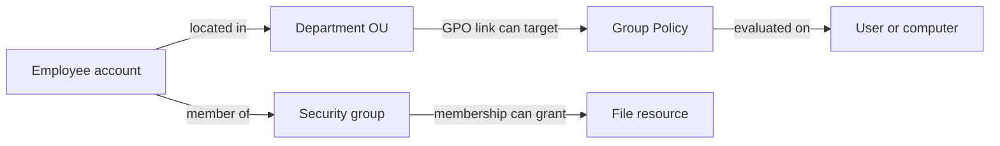

# Inside the Nova Corp directory

**[Open the complete verified directory inventory (22 November 2026)](DIRECTORY_SNAPSHOT_2026-11-22.md)**

[← Active Directory](services/ACTIVE_DIRECTORY.md) · [Meet the people](PEOPLE_AND_DEPARTMENTS.md) · [Security groups](GROUPS.md) · [Group Policy](POLICIES.md)

An **Organizational Unit (OU)** is a folder-like container for directory objects. It helps administrators organize the company and attach policies to the right users or computers.

## Explore the directory tree

<strong>nova.corp — Company directory</strong>

<strong>Nova Users — Employee and contractor accounts</strong>

- [Finance department](people/DEPARTMENTS.md#finance)
- [Human Resources](people/DEPARTMENTS.md#human-resources)
- [IT department](people/IT_DEPARTMENT.md) — [David](people/DAVID.md), [Moyo](people/MOYO.md), [Isaac](people/accounts/cr011-it.md)
- [Management](people/DEPARTMENTS.md#management)
- [Sales](people/DEPARTMENTS.md#sales)
- **Contractors** — [John Shaw](people/JOHN_SHAW.md), contractor test account documented in the GPO journal

<strong>Nova Computers</strong>

- **Workstations** — [NOVA-CLIENT](systems/NOVA-CLIENT.md)
- **Servers** — member-server organizational area

<strong>Nova Security Groups</strong>

[IT_Users](GROUPS.md#it_users) · [Finance_Users](GROUPS.md#finance_users) · [HR_Users](GROUPS.md#hr_users) · [Sales_Users](GROUPS.md#sales_users) · [Management_Users](GROUPS.md#management_users) · [Resource permission groups](GROUPS.md#resource-permission-groups)

<strong>Nova Service Accounts</strong>

- `svc_backup` — created for backup-related service identity
- `svc_monitoring` — created for future monitoring identity
- `svc_fileserver` — created for file-server-related service identity

These accounts were created during directory setup; the original journal did not claim every account was already executing a running service.

<strong>Other administrative areas</strong>

- Nova Administrative Accounts
- Nova Disabled Objects
- Nova Resources

<strong>Built-in Domain Controllers OU</strong>

- [NOVA-DC01](systems/NOVA-DC01.md)
- [NOVA-DC02](systems/NOVA-DC02.md)

Domain Controllers remain in the built-in AD organizational unit rather than the custom member-server OU.

## How OUs, groups and policies relate

OU location organizes. A group membership can authorize a resource or help filter a policy. A policy link alone is not proof that the resulting setting applied.

## Explore real examples

- [Moyo's group membership and file access](people/MOYO.md)
- [John Shaw's contractor policy](people/JOHN_SHAW.md)
- [IT share permission chain](FILE_SERVICES.md)
- [Group Policy settings and tests](POLICIES.md)

**How the directory was organized:** [Original OU, user and group journal](../Documentation/Change-Requests/Journal-CR-005.md).

*The structure and current account placement were cross-checked against the read-only inventory collected on 22 November 2026.*