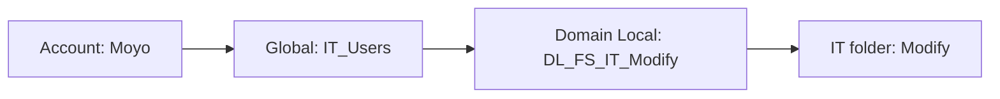

# Security groups — Who is allowed to do what?

[← Directory tree](DIRECTORY.md) · [People](PEOPLE_AND_DEPARTMENTS.md) · [Files](FILE_SERVICES.md) · [Group Policy](POLICIES.md)

At the **22 November 2026** snapshot, the domain contained **62 security groups**, including **11 groups created for Nova Corp's departmental access model**. [See every current direct member and resource group](DIRECTORY_SNAPSHOT_2026-11-22.md).

A **security group** collects accounts that share a responsibility. Instead of granting a folder permission separately to each employee, Nova Corp assigns permission to a group.

## Department groups

The directory setup created these five **Global Security** groups:

| Group | Department | Connected people or resources |
| --- | --- | --- |
| **IT_Users** | IT | [David](people/DAVID.md), [Moyo](people/MOYO.md), [Isaac](people/accounts/cr011-it.md), [IT folder](FILE_SERVICES.md#it) |
| **Finance_Users** | Finance | [Finance share](FILE_SERVICES.md#finance) |
| **HR_Users** | HR | [HR department](people/DEPARTMENTS.md#human-resources) |
| **Sales_Users** | Sales | [Sales department](people/DEPARTMENTS.md#sales) |
| **Management_Users** | Management | [Management department](people/DEPARTMENTS.md#management) |

The David/Moyo membership was observed during the original directory setup. Later tests revalidated Moyo's IT authorization.

## Resource permission groups

The file-access and automation journals give concrete Domain Local group examples.

| Group | Purpose | Evidence |
| --- | --- | --- |
| `DL_FS_IT_Modify` | Allows IT folder modification | Moyo membership and matching SMB+NTFS checks |
| `DL_FS_Finance_Modify` | Finance folder modification | NTFS permission review |
| `DL_FS_Finance_FullControl` | Higher-level Finance resource control | Management access test |
| `DL_FS_HR_Modify` | HR folder modification | `HR_Users` nesting |
| `DL_FS_Management_Modify` | Management folder modification | `Management_Users` nesting |
| `DL_FS_Sales_Modify` | Sales folder modification | `Sales_Users` nesting |

These permissions connect to [NOVA-FILES01](systems/NOVA-FILES01.md).

## Why two group layers?

Nova Corp uses the **AGDLP** pattern:

Accounts are assigned to business groups. Those groups are nested where appropriate into resource-permission groups, which are attached to folder ACLs.

## What the lab actually proved

Moyo:
- `IT_Users` (Global)
- `DL_FS_IT_Modify` (Domain Local)
- IT: allowed
- Finance: denied

[Open Moyo's profile and test](people/MOYO.md).

## Group Policy filtering

A security group may also target a policy.

The contractor USB policy was linked to an OU and tested with John Shaw. The `USB_Authorized` group was part of the exception design; the physical USB-device end-to-end test was deferred due to nested device-passthrough limitations.

[Read Group Policy](POLICIES.md).

**Engineering records:** [Identity and group creation](../Documentation/Change-Requests/Journal-CR-005.md) · [Test-UserAccess and membership checks](../Documentation/Change-Requests/CR-011_PowerShell_Administration_Toolkit.md).