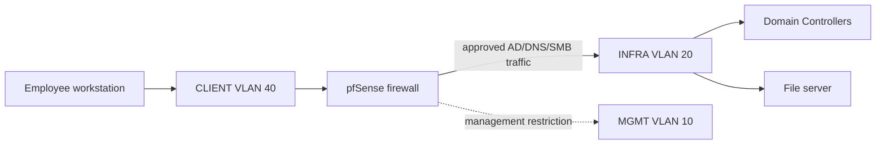
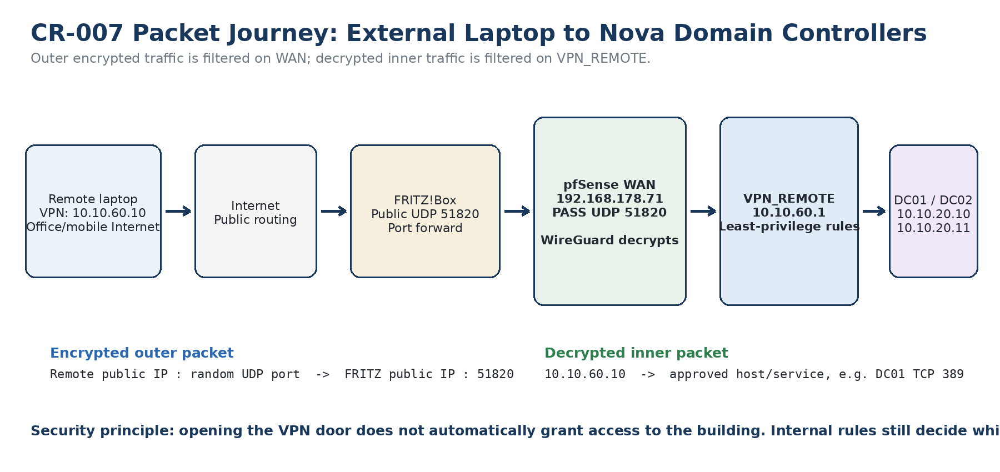

# Network Gatehouse — pfSense and network zones

Nova Corp uses [pfSense](systems/NOVA-FW01.md) as its firewall and gateway between several networks. Separating networks means employees can reach what they need without automatically receiving access to every management interface.

## Select a network

| Area | Subnet | Gateway | What lives there |
| --- | --- | --- | --- |
| **Upstream host** | `192.168.178.0/24` | `192.168.178.1` | Proxmox management; pfSense WAN |
| **Legacy LAN** | `10.99.99.0/24` | `10.99.99.1` | Legacy internal segment |
| **MGMT / VLAN 10** | `10.10.10.0/24` | `10.10.10.1` | Firewall management interface |
| **INFRA / VLAN 20** | `10.10.20.0/24` | `10.10.20.1` | [DC01](systems/NOVA-DC01.md), [DC02](systems/NOVA-DC02.md), [FILES01](systems/NOVA-FILES01.md) |
| **APP / VLAN 30** | `10.10.30.0/24` | `10.10.30.1` | Reserved application segment |
| **CLIENT / VLAN 40** | `10.10.40.0/24` | `10.10.40.1` | [NOVA-CLIENT](systems/NOVA-CLIENT.md) |
| **DMZ / VLAN 50** | `10.10.50.0/24` | `10.10.50.1` | Reserved public-service segment |
| **VPN_REMOTE / VLAN 60** | `10.10.60.0/24` | `10.10.60.1` | Remote WireGuard peers |

## How routing and firewall policy work

## Open the parts of the firewall

[pfSense server profile](systems/NOVA-FW01.md) · [Firewall rules explained](services/FIREWALL.md) · [WireGuard VPN](services/WIREGUARD.md) · [DNS Resolver](services/DNS.md).

## What was tested

**Firewall and VLAN foundation:** Routing, gateways, DHCP, WAN and firewall rules were configured and validated.

**VPN:** A failed WireGuard handshake was traced through packet arrival, firewall counters and peer authentication before being repaired.

**Management isolation:** Final validation found and corrected a management interface path reachable by an ordinary client. The repair was tested against blocked management traffic and required application traffic.

**Unfinished security work:** Proxmox management is still on the upstream host network; the dedicated privileged-admin VPN is the next security milestone.

## Visual explanation

*The connection must pass several network and policy layers before an internal service can respond.*

**Engineering depth:** [Network foundation](../Documentation/Change-Requests/Journal-CR-002.md) · [VPN and firewall packet journey](../Documentation/Change-Requests/Journal-CR-007.md) · [Management validation](../Documentation/Change-Requests/CR-015_Phase_2_Validation_and_Closure.md).

[← Company map](../EXPLORE_NOVACORP.md)