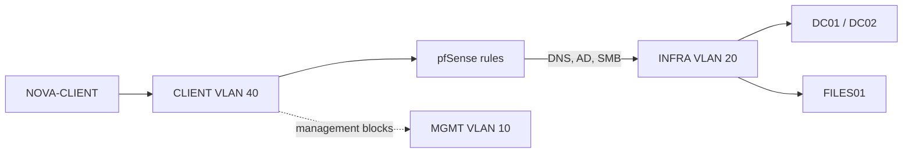

# Network Gatehouse — How Nova Corp stays connected

Nova Corp uses a **pfSense firewall** to connect the company's networks. Staff, servers, management tools and remote laptops are placed in different network areas. Each area has its own gateway, and firewall rules decide which traffic can cross.

**[Open the pfSense firewall](systems/NOVA-FW01.md)** · **[Inspect every firewall rule](network/RULES.md)** · **[See the five aliases](network/ALIASES.md)**

## Choose a network area

| Network | Address / gateway | What it is used for | Explore |
| --- | --- | --- | --- |
| WAN | DHCP on `vtnet0` | Connection to the upstream router | [WAN](network/zones/WAN.md) |
| LAN | `10.99.99.0/24` / `10.99.99.1` | Original internal network | [LAN](network/zones/LAN.md) |
| MGMT · VLAN 10 | `10.10.10.0/24` / `10.10.10.1` | Management interface area | [MGMT](network/zones/MGMT.md) |
| INFRA · VLAN 20 | `10.10.20.0/24` / `10.10.20.1` | Domain Controllers and file server | [INFRA](network/zones/INFRA.md) |
| APP · VLAN 30 | `10.10.30.0/24` / `10.10.30.1` | Application network for future workloads | [APP](network/zones/APP.md) |
| CLIENT · VLAN 40 | `10.10.40.0/24` / `10.10.40.1` | Employee test workstation | [CLIENT](network/zones/CLIENT.md) |
| DMZ · VLAN 50 | `10.10.50.0/24` / `10.10.50.1` | Network for future public services | [DMZ](network/zones/DMZ.md) |
| VPN_REMOTE · WireGuard | `10.10.60.0/24` / `10.10.60.1` | Remote-access laptop | [VPN_REMOTE](network/zones/VPN_REMOTE.md) |

The export confirms **five actual 802.1Q VLANs (10–50)**. VPN_REMOTE is a **WireGuard tunnel**, not an 802.1Q VLAN.

## Follow an employee request

The two CLIENT block rules come before a more general CLIENT allow rule. [See their exact order and settings](network/RULES.md#client).

## What is configured?

The pfSense configuration exported **22 November 2026** contains:

| Component | Count / configuration |
| --- | --- |
| Interfaces | **8** |
| VLAN subinterfaces | **5** |
| Explicit firewall filter rules | **17: 13 pass, 4 block** |
| Aliases | **5** |
| DHCP scopes | **6**, configured enabled |
| WireGuard | **1 enabled tunnel, 1 enabled remote peer** |
| DNS Resolver | Enabled; `nova.corp` override → DC01 |
| NAT | Automatic outbound NAT; no manual port-forward rule inside this pfSense export |
| Web administration | HTTPS |

These are exported **configuration facts**, not proof that every connection succeeds or that every VLAN is fully isolated. For example, INFRA, APP and DMZ each have a broad outbound allow rule. Stronger management separation is the next security milestone.

## Explore the working parts

[Firewall rule order](network/RULES.md) · [Network aliases](network/ALIASES.md) · [DHCP](network/DHCP.md) · [NAT and gateways](network/NAT_AND_GATEWAYS.md) · [DNS Resolver](services/DNS.md) · [Remote WireGuard VPN](services/WIREGUARD.md).

## What happened during testing?

The VPN initially received packets but failed to complete a handshake; the peer configuration was corrected and retested. Later, a normal workstation reached management paths more broadly than intended. CR-015 introduced more specific block rules, followed by allowed/denied regression checks.

[View all incidents](TESTS_AND_RECOVERY.md) · [Full VPN journal](../Documentation/Change-Requests/Journal-CR-007.md) · [Phase 2 closure](../Documentation/Change-Requests/CR-015_Phase_2_Validation_and_Closure.md).

*Inventory based on the configuration exported 22 November 2026. Rule contents can change when a new security change is implemented.*

[← Enter Nova Corp](../EXPLORE_NOVACORP.md)