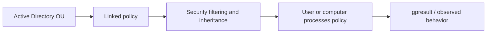

# Workstation Rules — Group Policy

Windows computers at Nova Corp don't need to be configured one at a time. **Group Policy** lets IT define settings once and deliver them to the right users or computers through Active Directory.

The company has **seven Group Policy Objects (GPOs)**. Six have active links to the domain or an OU; one is an unused, empty GPO.

## Explore the seven policies

| Policy | Where it is linked | What it controls |
| --- | --- | --- |
| **[Default Domain Policy](policies/DOMAIN_PASSWORD.md)** | Entire `nova.corp` domain | Password rules, account lockout, Kerberos settings |
| **[Default Domain Controllers Policy](policies/DEFAULT_DC.md)** | [Domain Controllers](systems/NOVA-DC01.md) OU | Domain Controller rights and security settings |
| **[Corporate wallpaper](policies/WALLPAPER.md)** | [Nova Users](DIRECTORY.md) | A shared company desktop wallpaper |
| **[Nova Corp - Keyboard](policies/KEYBOARD.md)** | **Not linked** | No settings configured in this GPO |
| **[Contractor removable-storage policy](policies/CONTRACTOR_USB.md)** | [Contractors](people/JOHN_SHAW.md) OU | Deny removable-storage access and write operations |
| **[Workstation security baseline](policies/WORKSTATION_BASELINE.md)** | [Workstations](systems/NOVA-CLIENT.md) OU | Firewall, AutoPlay and SMBv1 configuration |
| **[Department drive mapping](policies/DRIVE_MAPPING.md)** | [Nova Users](DIRECTORY.md) | Run the departmental drive-mapping script at sign-in |

All six existing links are **enabled** and **not enforced**. All seven GPO security descriptors give **Authenticated Users** permission to apply policy, subject to the GPO's actual scope and processing rules.

The names above are visitor-friendly. Each individual policy page includes its exact configured GPO name.

## How a policy reaches someone

For example, [John Shaw](people/JOHN_SHAW.md) lives in the Contractors OU, which has a linked removable-storage restriction. The earlier test showed that policy in his `gpresult` output.

A GPO link proves where IT has **assigned** a setting. To prove it actually **applied**, you also check the client and the resulting behavior.

## Connected parts of Nova Corp

[Open the directory tree](DIRECTORY.md) → [Select a staff account](PEOPLE_AND_DEPARTMENTS.md) → [Find its OU](DIRECTORY_SNAPSHOT_2026-11-22.md) → [Explore a policy](POLICIES.md) → [See tests and incidents](TESTS_AND_RECOVERY.md).

The drive-mapping policy also connects to [SMB and file access](FILE_SERVICES.md). The workstation baseline connects to [NOVA-CLIENT](systems/NOVA-CLIENT.md), and the Domain Controllers policy connects to [DC01](systems/NOVA-DC01.md) and [DC02](systems/NOVA-DC02.md).

## What we discovered during configuration review

- The configured maximum password age is **180 days**, not the earlier 90-day figure.
- The actual wallpaper GPO is named **`Nova Corp - Coperate wallpaper`**, including the typo.
- **`Nova Corp - Keyboard`** currently has no link or settings; keyboard-layout preferences actually appear in the Default Domain Controllers Policy.
- The department drive-mapping GPO executes a script from `NETLOGON`.
- Domain Controller LDAP signing is configured as **None**; this is a separate security-hardening item to verify and address.

## See how it was implemented and tested

[Group Policy build journal](../Documentation/Change-Requests/Journal-CR-006.md) · [Department share mapping](../Documentation/Change-Requests/NovaCorp_CR-009_Departmental_Shares_and_Drive_Mapping.pdf) · [GPO incident exercises](../Documentation/Change-Requests/CR-014_Phase_2_Incident_Exercises.md) · [Final baseline export](../Documentation/Change-Requests/CR-015_Phase_2_Validation_and_Closure.md).

*These are the last documented policy settings. Client-side application and script execution are covered by separate tests.*

[← Explore Nova Corp](../EXPLORE_NOVACORP.md)