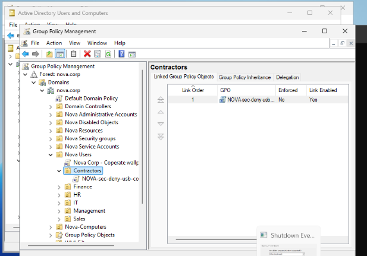
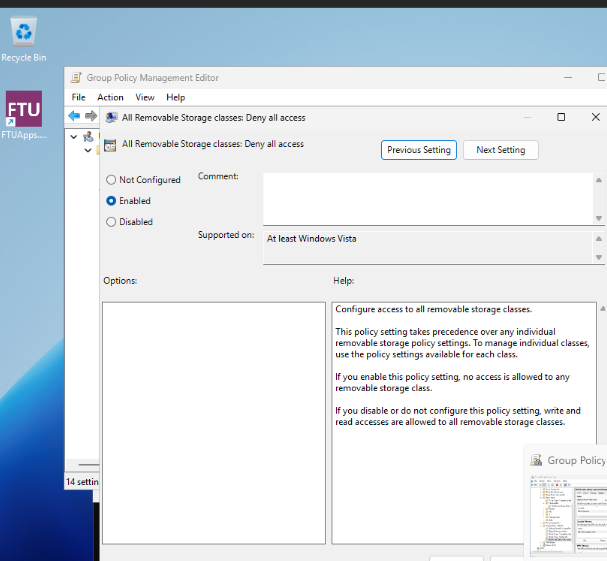
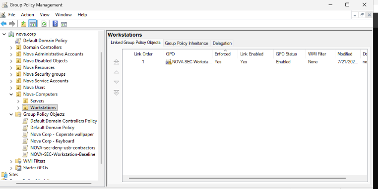

# Workstation Rules — Group Policy

A **Group Policy (GPO)** is a set of Windows settings that the domain can apply to selected users or computers. It is one way Nova Corp keeps workstations consistent instead of manually configuring every device.

Policies connect to [Active Directory](services/ACTIVE_DIRECTORY.md), the [OU tree](DIRECTORY.md), [security groups](GROUPS.md) and the [Windows client](systems/NOVA-CLIENT.md).

## Open a policy

### [Domain password and account-lockout rules](policies/DOMAIN_PASSWORD.md)

The historical domain-policy baseline included:
- Minimum password length: 12 characters
- Password complexity: enabled
- Maximum password age: 90 days
- Lockout after 5 failed attempts
- Lockout duration: 15 minutes

The lockout controls were also used in a controlled administration test.

[Read the password/lockout settings and tests](../Documentation/Change-Requests/Journal-CR-006.md).

### [Corporate wallpaper](policies/WALLPAPER.md)

The `Nova Corp - Corporate wallpaper` policy provides a consistent desktop look and demonstrates user-policy application.

The contractor test account's `gpresult` showed this wallpaper policy together with the contractor USB restriction.

### [Contractor removable-storage restriction](policies/CONTRACTOR_USB.md)

GPO: `NOVA-sec-deny-usb-contractors`  
OU: `Nova Users → Contractors`

Contractors received a policy denying all removable-storage classes. This was verified as **policy processing** on John Shaw; physical USB passthrough could not be reliably tested in the nested virtual environment.

[Open John Shaw's profile](people/JOHN_SHAW.md).

### [Workstation security baseline](policies/WORKSTATION_BASELINE.md)

GPO: `NOVA-SEC-Workstation-Baseline`  
Target: `Nova Computers → Workstations`

The implementation covered workstation firewall settings, disabling AutoPlay/AutoRun and SMBv1 configuration.

The baseline's `Enforced` setting was corrected from an earlier over-broad configuration. The documented test showed SMBv1 disabled while SMBv2 remained enabled.

### Policies studied, not applied as live controls

The `NOVA-SEC-User-Lockdown` restriction policy was explored through a tabletop scenario. Its group-targeting design must not be confused with an applied and validated production-like GPO.

The `USB_Authorized` group was part of the approved exception design; the physical USB test remained open.

## How a policy reaches a computer

A GPO existing or being linked does **not** automatically prove its intended setting affected a user. Nova Corp used `gpresult` and client-side checks to distinguish configuration from effective behavior.

## Phase 2 baseline

At closure, **seven current GPOs were exported and matched to seven backup folders**. Their exact current settings are documented in the private baseline exports, while the historical public journal explains the specific implemented controls above.

## Incidents and proof

[Group Policy incident tests](TESTS_AND_RECOVERY.md) · [Original implementation journal](../Documentation/Change-Requests/Journal-CR-006.md).

[← Company map](../EXPLORE_NOVACORP.md)