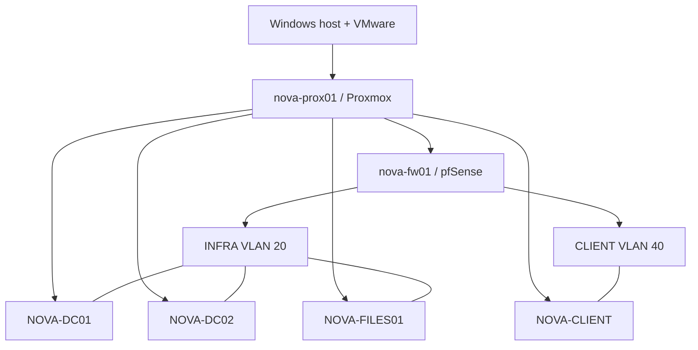

# IT Control Room — Computers and servers

Nova Corp runs **six Proxmox virtual machines** at the 22 November 2026 inventory: five running company VMs and one stopped, unassigned VM201. Choose a machine to see the services inside it, its network connection, disks and tests. Select one to see the services inside it, its network connection and the tests involving it.

| Machine | What it does | Open |
| --- | --- | --- |
| **NOVA-DC01** | Domain identity and DNS | [Explore DC01](systems/NOVA-DC01.md) |
| **NOVA-DC02** | Second domain identity and DNS; resilience | [Explore DC02](systems/NOVA-DC02.md) |
| **NOVA-FILES01** | Department files, DFS and backup | [Explore file server](systems/NOVA-FILES01.md) |
| **NOVA-CLIENT** | Windows workstation for user-facing tests | [Explore workstation](systems/NOVA-CLIENT.md) |
| **nova-fw01** | pfSense firewall, router and VPN | [Explore firewall](systems/NOVA-FW01.md) |
| **nova-prox01** | Proxmox hypervisor hosting VMs | [Explore hypervisor](systems/NOVA-PROX01.md) |
| **VM201** | Stopped/unassigned Windows VM configuration | [Open VM201 inventory](virtualization/vms/201.md) |

**[View the virtualization floor — all six VMs, two bridges and three storage backends](virtualization/README.md)**

## How the machines connect

The arrows distinguish the outer hosting relationship from pfSense's traffic-routing zones. Not every server "connects through" pfSense to communicate with another server in its own subnet.

## Choose a service instead

[Active Directory](services/ACTIVE_DIRECTORY.md) · [DNS](services/DNS.md) · [Kerberos/KDC](services/KERBEROS.md) · [LDAP](services/LDAP.md) · [SYSVOL/NETLOGON](services/SYSVOL_NETLOGON.md) · [SMB](services/SMB.md) · [DFS](services/DFS.md) · [Backup](services/BACKUPS.md).

## Choose a test

[DC failover](incidents/domain-controller-outage.md) · [File permissions](FILE_SERVICES.md) · [Management firewall hardening](NETWORK.md) · [Restore proof](services/BACKUPS.md).

[← Company map](../EXPLORE_NOVACORP.md)