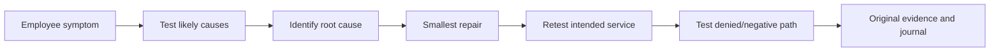

# Incident Lab — What broke, what we tested, how it recovered

**Every investigation below opens a technical walkthrough.** Start with the problem in plain English, then expand into the actual commands, expected results, observed output, root cause, repair and supporting journals.

An incident doesn't end when a VM turns green. Nova Corp tests whether employees can still sign in, find services, access the files they should, and recover after failures.

## Choose an investigation

| Investigation — click to open | The problem | Result |
| --- | --- | --- |
| **[Proxmox default gateway failure](incidents/proxmox-default-gateway.md)** | Local management worked, but the host couldn't reach outside networks | Repaired · validated |
| **[Proxmox WebGUI outage](incidents/proxmox-webgui-outage.md)** | Web console unavailable while SSH and VMs remained operational | Repaired · validated |
| **[Domain Controller VLAN migration](incidents/dc01-vlan-migration.md)** | DC01 lost outbound connectivity after moving into INFRA | Repaired · validated |
| **[WireGuard handshake failure](incidents/wireguard-handshake.md)** | Encrypted packets arrived at pfSense but peer authentication did not complete | Repaired · validated |
| **[Bulk user creation rollback](incidents/bulk-users-partial-rollback.md)** | Weak password left disabled, half-created user accounts | Corrected and re-tested |
| **[False denial in access-audit script](incidents/group-acl-name-mismatch.md)** | Group names and ACL identities didn't match as strings | Corrected · positive/negative tests |
| **[Domain Controller outage](incidents/domain-controller-outage.md)** | DC01 unavailable; DC02 had to carry domain services | Continuity and recovery PASS |
| **[Active Directory replication divergence](incidents/replication-divergence.md)** | Two healthy-looking DCs contained different AD objects | Natural convergence PASS |
| **[Single-folder NTFS denial](incidents/file-permission-denial.md)** | Moyo could access IT but not one child folder | Minimal ACL repair PASS |
| **[Client DNS misconfiguration](incidents/dns-client-outage.md)** | File share failed by name, worked by direct IP | DNS repaired PASS |
| **[Wallpaper GPO link disabled](incidents/gpo-link-disabled.md)** | User wallpaper stopped applying while Group Policy otherwise worked | Link repaired PASS |
| **[Backup disk failure and verified restore](incidents/backup-target-disappears.md)** | Backup storage was offline; recovery needed to be proven | File restored, SHA-256 exact match |
| **[Two faults, one misleading symptom](incidents/two-faults-one-symptom.md)** | Wrong DNS record concealed missing group membership | Both causes repaired PASS |
| **[Employee access to firewall management](incidents/pfsense-management-exposure.md)** | CLIENT could reach sensitive management paths | Targeted blocks + business regression PASS |
| **[Proxmox snapshot storage pressure](incidents/proxmox-snapshot-pressure.md)** | Twenty stale snapshots drove local-lvm to 86.73% used | Retention cleanup, 52.88% |
| **[Independent external-VPN fault test](incidents/vpn-external-validation-deferred.md)** | Required external test laptop was unavailable in CR-014 | **Deferred** — not reported as a pass |

## What happens inside each investigation?

Each walkthrough distinguishes **what the test was expected to show** from **what it actually showed**. Where an intermediate attempt failed, that lesson is preserved instead of erased.

## Find incidents by system

[Identity and Domain Controllers](IDENTITY.md) · [Network and pfSense](NETWORK.md) · [File server](FILE_SERVICES.md) · [Backups](services/BACKUPS.md) · [PowerShell automation](AUTOMATION.md) · [Group Policy](POLICIES.md) · [Proxmox](virtualization/README.md).

## Original technical evidence

The walkthroughs are readable summaries of the actual engineering records. The original sources remain available: [Proxmox failure tests](../Documentation/failure-testing-report.md), [WireGuard investigation](../Documentation/Change-Requests/Journal-CR-007.md), [PowerShell toolkit](../Documentation/Change-Requests/CR-011_PowerShell_Administration_Toolkit.md), [AD resilience](../Documentation/Change-Requests/CR-013_Secondary_Domain_Controller_and_AD_Resilience_Journal.md), [illustrated incident journal (PDF)](../Documentation/Change-Requests/Nova_Corp_CR-014_Engineering_Journal_and_Evidence.pdf), and [Phase 2 closure](../Documentation/Change-Requests/CR-015_Phase_2_Validation_and_Closure.md).

[← Explore Nova Corp](../EXPLORE_NOVACORP.md)