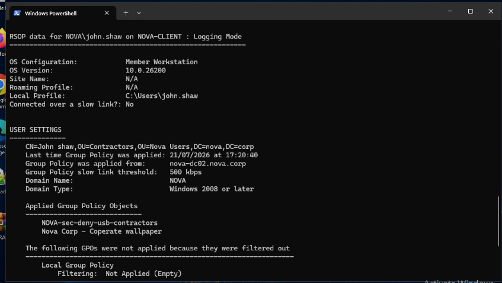

# John Shaw — Contractor policy test account

John Shaw is a fictional contractor account used to validate Group Policy targeting.

| Field | Recorded test information |
| --- | --- |
| Display name | John Shaw |
| Tested logon | `NOVA\john.shaw` |
| OU | `Nova Users → Contractors` |
| Applied policy | `NOVA-sec-deny-usb-contractors` |
| Also applied | `Nova Corp - Corporate wallpaper` |

## What was the policy supposed to do?

Contractors should not be able to use removable storage even if a generic exception exists for approved staff.

The lab linked the contractor policy to the Contractors OU and confirmed its processing through `gpresult`. Physical USB behavior was not verified end-to-end because passing a physical USB device through the nested virtualization stack was unreliable.

## See the actual screenshot

[Policy details](../POLICIES.md#contractor-usb-restriction) · [Group Policy journal](../../Documentation/Change-Requests/Journal-CR-006.md).

[← People & Departments](../PEOPLE_AND_DEPARTMENTS.md)