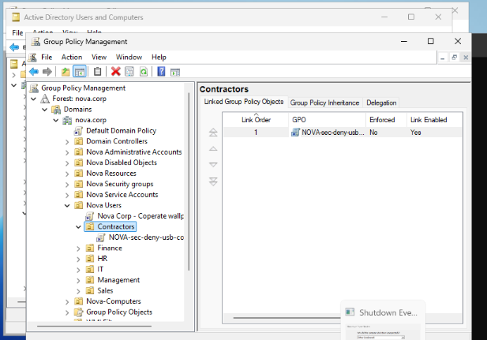
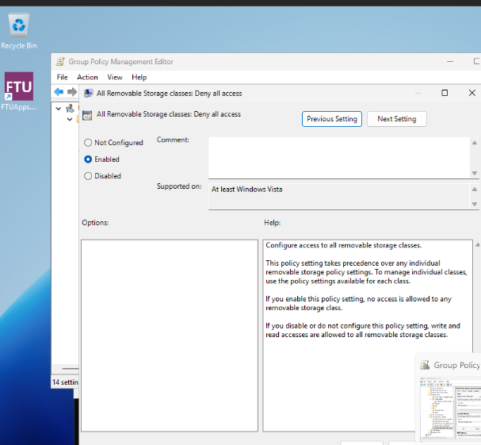
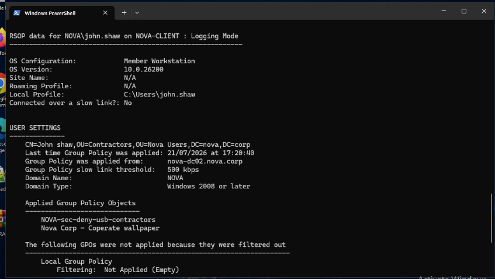

# Contractor removable-storage policy

**GPO:** `NOVA-sec-deny-usb-contractors`  
**Target:** `Nova Users → Contractors` OU

## Why it exists

Contractor accounts should not be able to use removable storage on company workstations.

## Configuration

In the user half of Group Policy, **All Removable Storage classes: Deny all access** was enabled.

### Link to the OU

### The configured restriction

## Test user

[John Shaw](../people/JOHN_SHAW.md) was located in the contractor OU. His `gpresult` output showed this policy in the applied list.

**What was not fully tested:** passing a physical USB device through the nested VMware/Proxmox/Windows chain was unreliable, so the documented result is policy configuration/application rather than a proven physical USB block.

## Connected concepts

[OU tree](../DIRECTORY.md) · [Windows client](../systems/NOVA-CLIENT.md) · [Group Policy](../POLICIES.md).

[Read original implementation and limits](../../Documentation/Change-Requests/Journal-CR-006.md).

[← All policies](../POLICIES.md)