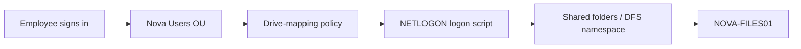

# Department drive mapping — Shared folders appear at sign-in

A file share is easier to use when employees don't need to remember server addresses. Nova Corp configured a Group Policy logon script to map company drives for users.

**GPO:** `NOVA-USER-Department-Drive-Mapping`  
**Linked to:** `nova.corp/Nova Users`  
**Link:** Enabled, not enforced  
**Configured as:** User logon script  
**Captured:** 22 November 2026

## What happens at sign-in?

This explains the intended flow. The **GPO report confirms the configured invocation**, not that the script successfully mapped a drive at the most recent logon.

## Actual script configuration

| Setting | Value |
| --- | --- |
| Program | `powershell.exe` |
| Arguments | `-NoProfile -ExecutionPolicy Bypass -File "\\nova.corp\NETLOGON\Map-DepartmentDrive.ps1"` |
| Script type | Logon |
| Order | 0 |
| Applies through | User configuration |

The command uses PowerShell's process-level execution-policy bypass. That is part of the documented configuration; it does not mean the script itself is digitally signed.

## Explore the connected services

[Nova Users OU](../DIRECTORY.md) → [Security groups](../GROUPS.md) → [SMB/NTFS access](../services/SMB.md) → [DFS](../services/DFS.md) → [NOVA-FILES01](../systems/NOVA-FILES01.md).

The script can only map an accessible folder: drive letters do **not** override group membership or NTFS permissions.

## How it was tested

The original file-server work documents department shares and drive mapping. Later tests confirmed the IT/Finance authorization result for a real domain user, which is related but not proof of the latest logon script execution.

[Read shares and drive mapping (PDF)](../../Documentation/Change-Requests/NovaCorp_CR-009_Departmental_Shares_and_Drive_Mapping.pdf) · [Read access-analysis tests](../../Documentation/Change-Requests/CR-011_PowerShell_Administration_Toolkit.md).

<strong>Technical identifier</strong>

GPO GUID: `90940df5-26d3-42b1-83e8-d73134e8eada`  
Security filtering: Authenticated Users (Apply Group Policy).

[← All seven GPOs](../POLICIES.md)