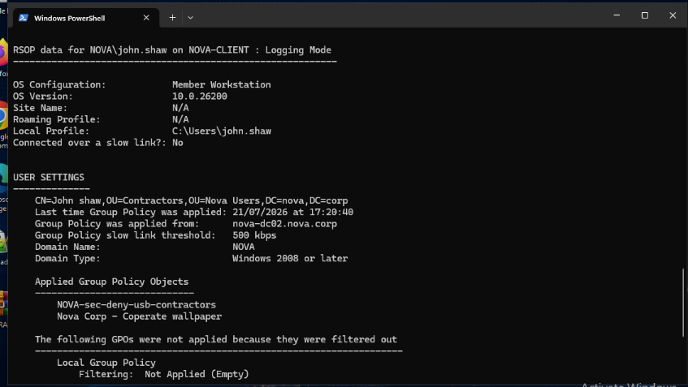

# Corporate wallpaper policy

## What it does

A common desktop wallpaper lets Nova Corp verify that a user-based Group Policy can be delivered to a domain workstation.

**Policy:** `Nova Corp - Corporate wallpaper`.

## Where it connects

[User account](../PEOPLE_AND_DEPARTMENTS.md) → [Organizational Unit](../DIRECTORY.md) → Group Policy processing → [NOVA-CLIENT](../systems/NOVA-CLIENT.md).

## How it was tested

The contractor test user **John Shaw** received the corporate wallpaper GPO alongside the contractor-specific removable-storage policy in `gpresult`.

The screenshot proves the policy appeared in the applied-user list; it does not, by itself, document the wallpaper file's path.

[John Shaw's profile](../people/JOHN_SHAW.md) · [Full policy journal](../../Documentation/Change-Requests/Journal-CR-006.md).

[← All policies](../POLICIES.md)