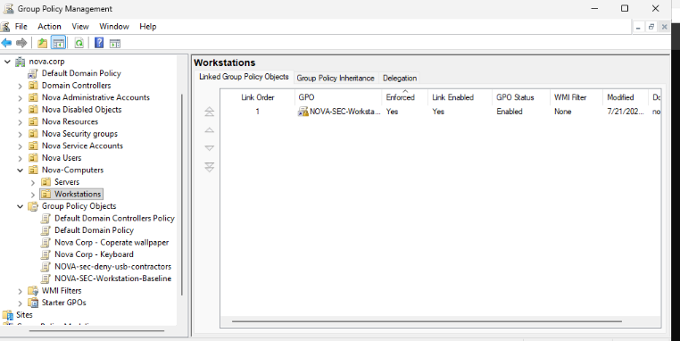
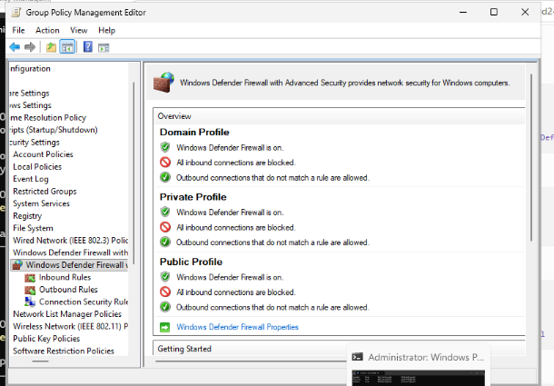

# Windows workstation security baseline

**GPO:** `NOVA-SEC-Workstation-Baseline`  
**Target:** `Nova Computers → Workstations` OU

## What it does

Instead of configuring every Windows workstation manually, Nova Corp applies a collection of basic computer security settings through Group Policy.

## Documented settings

- Windows Defender Firewall enabled through domain policy configuration.
- AutoPlay turned off on all drives.
- AutoRun command execution disabled.
- SMBv1 registry policy value set to `0`.

The original validation showed SMBv1 server support disabled while SMBv2 remained enabled on the tested machine.

## How it is targeted

This is **computer-side policy**. It follows the computer object in the Workstations OU, rather than being linked only to the person who logs in.

### Evidence

The baseline's Enforced setting was corrected from its initial configuration to avoid unintended override behavior.

## Tests

The journal records:
- GPO link and computer policy processing;
- SMBv1/SMBv2 checks;
- Firewall profile configuration;
- errors encountered when running `gpresult` without the appropriate context.

[Workstation profile](../systems/NOVA-CLIENT.md) · [Directory tree](../DIRECTORY.md) · [Policy processing incidents](../TESTS_AND_RECOVERY.md).

[Read original Group Policy journal](../../Documentation/Change-Requests/Journal-CR-006.md).

[← All policies](../POLICIES.md)