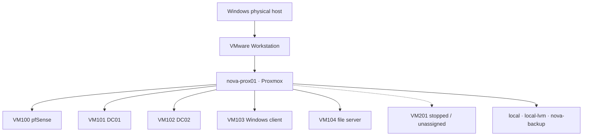

# The Virtualization Floor — How Nova Corp's computers actually run

Nova Corp's office, directory servers, file services and network firewall are **virtual machines**. A Windows computer runs VMware Workstation; inside it, **nova-prox01** runs Proxmox VE; Proxmox runs the company VMs.

This isn't a diagram of what we planned to build. It is the actual **22 November 2026 hypervisor inventory**.

## Enter the virtual data centre

## Open any virtual machine

| VM | Current Proxmox label | State | What it runs |
|---:|---|---|---|
| **[100](vms/100.md)** | nova-fw01 | Running | pfSense firewall, VLAN routing, WireGuard |
| **[101](vms/101.md)** | nova-dc01 | Running | Domain Controller, AD DS, DNS |
| **[102](vms/102.md)** | nova-dc02 | Running | Second Domain Controller, DNS and resilience |
| **[103](vms/103.md)** | nova-client01 | Running | The Windows workstation known inside AD as **NOVA-CLIENT** |
| **[104](vms/104.md)** | nova-files01 | Running | SMB/DFS, Shadow Copies, Windows backups |
| **[201](vms/201.md)** | VM-201 | **Stopped** | Unassigned spare VM; role not established |

Each VM profile lists the actual virtual NIC, VLAN tag, disks, storage backend and related business services.

## The network underneath every VM

[**vmbr0 — Outer management and firewall WAN**](bridges/vmbr0.md) uses `192.168.178.26/24` on the host. [**vmbr1 — Company transit and VLAN switching**](bridges/vmbr1.md) connects pfSense's internal NIC, DCs, file server and workstations. On this bridge, DC01/DC02/FILES01 use tag **20**, the Windows client uses tag **40**, and pfSense handles the five tagged networks.

**[Open the firewall and network rule explorer](../NETWORK.md)**.

## Storage and recovery

| Storage | Used at 22 Nov 16:03 | What is stored |
|---|---:|---|
| [local](storages/local.md) | 63.12% | Proxmox local directory and ISO images |
| [local-lvm](storages/local-lvm.md) | **53.67%** | Thin-provisioned virtual disks and one retained snapshot |
| [nova-backup](storages/nova-backup.md) | 22.30% | vzdump backup archives **and two active qcow2 VM disks** |

[Explore all backups, the configured schedule and retained snapshot](BACKUPS.md).

The collected inventory contains **6 VMs, 0 containers, 7 virtual NICs, 28 disk/media attachments, 3 storage backends, 22 host network interfaces, 6 backup archives and 1 retained VM snapshot**. The 28 attachments include CD-ROM devices, ISOs and no-media entries; they are **not** 28 independent data disks.

## Reliability tests and failures

- [Hypervisor gateway misconfiguration](../incidents/proxmox-default-gateway.md): local network remained reachable, internet failed; recovered through configuration rollback.
- [WebGUI failure](../incidents/proxmox-webgui-outage.md): Proxmox HTTP management died, but SSH and VMs remained usable.
- [Snapshot storage pressure](../incidents/proxmox-snapshot-pressure.md): old snapshots pushed local-lvm to **86.73%**. Retention cleanup reduced it to **52.88%**, with the later capture at **53.67%**.

## What this inventory does not prove

A VM marked Running does **not** prove the Windows services inside it are healthy. The [Domain Controller outage](../incidents/domain-controller-outage.md), [file recovery](../incidents/backup-target-disappears.md) and [firewall test](../incidents/pfsense-management-exposure.md) separately demonstrate application-level behavior.

**[Full build journal](../../Documentation/Change-Requests/Journal-CR-001.md)** · [Company systems](../SYSTEMS.md) · [Company explorer](../../EXPLORE_NOVACORP.md)

*Read-only Proxmox capture: 22 November 2026, 16:03:54 Europe/Brussels. The virtualized lab shares a physical host; a separate virtual disk is not automatically an off-site backup.*