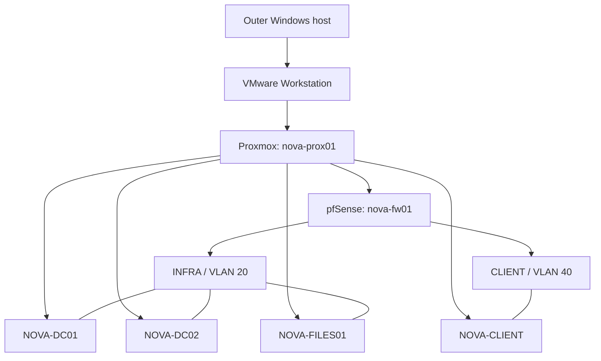
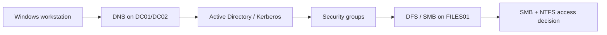

# How Nova Corp fits together

Nova Corp runs as a nested lab: a Windows host runs VMware Workstation; VMware runs Proxmox; Proxmox hosts the company's virtual machines. pfSense controls routed traffic between network segments.

This diagram shows the key systems and their roles, rather than every virtual cable.

## Open a server

| System | Main role | Documented address |
| --- | --- | --- |
| [nova-prox01](/reference/explore/systems/NOVA-PROX01/) | Nested hypervisor | `192.168.178.26` on upstream network |
| [nova-fw01 / pfSense](/reference/explore/systems/NOVA-FW01/) | Firewall/router, DNS Resolver and VPN | WAN `192.168.178.71`; several internal gateways |
| [NOVA-DC01](/reference/explore/systems/NOVA-DC01/) | AD DS and DNS | `10.10.20.10` |
| [NOVA-DC02](/reference/explore/systems/NOVA-DC02/) | Second AD DS and DNS | `10.10.20.11` |
| [NOVA-FILES01](/reference/explore/systems/NOVA-FILES01/) | SMB, DFS, VSS and backup | `10.10.20.20` |
| [NOVA-CLIENT](/reference/explore/systems/NOVA-CLIENT/) | User and policy test workstation | `10.10.40.100` |

## Network zones

| Zone | Subnet | Gateway | State |
| --- | --- | --- | --- |
| Upstream | `192.168.178.0/24` | `192.168.178.1` | Proxmox management and firewall WAN |
| Legacy LAN | `10.99.99.0/24` | `10.99.99.1` | Configured older segment |
| MGMT / VLAN 10 | `10.10.10.0/24` | `10.10.10.1` | Firewall management |
| INFRA / VLAN 20 | `10.10.20.0/24` | `10.10.20.1` | Domain Controllers and file server |
| APP / VLAN 30 | `10.10.30.0/24` | `10.10.30.1` | Reserved segment |
| CLIENT / VLAN 40 | `10.10.40.0/24` | `10.10.40.1` | Domain workstation |
| DMZ / VLAN 50 | `10.10.50.0/24` | `10.10.50.1` | Reserved segment |
| VPN_REMOTE / VLAN 60 | `10.10.60.0/24` | `10.10.60.1` | WireGuard peer network |

[Explore the network in plain English](/reference/explore/NETWORK/).

## Follow a normal employee request

[Open Active Directory](/reference/explore/services/ACTIVE_DIRECTORY/) · [Open file permissions](/reference/explore/FILE_SERVICES/) · [Open Group Policy](/reference/explore/POLICIES/).

## What happens when something fails?

Nova Corp uses several recovery paths: a second Domain Controller, AD Recycle Bin, file Previous Versions, Windows Server Backup, Proxmox VM backups and pfSense rollback snapshots.

[Explore backup/recovery](/reference/explore/services/BACKUPS/) · [Browse tests](/reference/explore/TESTS_AND_RECOVERY/).

## What is still a lab limitation?

Proxmox is actually managed on the upstream host network, not yet inside the final privileged-management VLAN design. The dedicated admin VPN and wider management-plane security change are next. The environment also shares one outer physical host failure domain.

**Documented state:** 20 November 2026 asset/network validation, with Phase 2 closure on 21 November 2026.

[← Company map](/reference/EXPLORE_NOVACORP/)