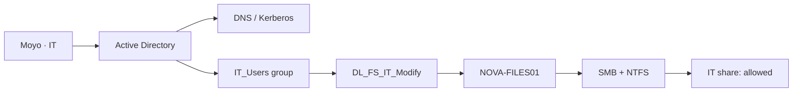

# Welcome to Nova Corp

**A fictional company built as a real, hands-on IT infrastructure lab.**

Imagine that you've joined Nova Corp. Employees need to sign in, teams need shared files, servers need to communicate, security rules need to work, and lost data needs to be recoverable.

You can explore those parts of the company here. Every highlighted system, service, policy or test leads to its related parts and, when you want it, the original engineering documentation.

## Choose where to go

| Area | What you'll find |
| --- | --- |
| 🖥️ **[IT Control Room — Servers and computers](/reference/explore/SYSTEMS/)** | The firewall, hypervisor, two Domain Controllers, file server and workstation. |
| 🏢 **[Virtual Data Centre — Proxmox](/reference/explore/virtualization/README/)** | Six VMs, virtual switches, storage, backups and rollback snapshots. |
| 🔑 **[Identity Office — Active Directory](/reference/explore/services/ACTIVE_DIRECTORY/)** | Login, DNS, Kerberos, LDAP, directory objects, replication and recovery. |
| 🧑‍💼 **[People and Departments](/reference/explore/PEOPLE_AND_DEPARTMENTS/)** | The company’s organizational units, staff/test identities and groups. |
| 🌐 **[Network Gatehouse — pfSense](/reference/explore/NETWORK/)** | Network zones, routing, VPN, firewall paths and tested restrictions. |
| 📁 **[File & Records Room](/reference/explore/files/SHARES/)** | Department folders, SMB/NTFS access, DFS and file recovery. |
| 🛡️ **[Workstation Rules — Group Policy](/reference/explore/POLICIES/)** | Domain password controls, wallpaper, USB restrictions, workstation security and validation. |
| ⚙️ **[Administration Toolkit](/reference/explore/AUTOMATION/)** | Eight PowerShell scripts that automate user and computer administration. |
| ♻️ **[Backup & Recovery Center](/reference/explore/services/BACKUPS/)** | What is backed up, where recovery copies go, and what restoring a file proved. |
| 🧪 **[Incident Lab — 16 investigations](/reference/explore/TESTS_AND_RECOVERY/)** | Click any problem to see actual commands, expectations, results, root causes and repairs. |
| 📋 **[Operations Room](/reference/explore/OPERATIONS/)** | How the environment is checked, recovered and maintained. |

**[Browse the company directory — every user, OU, company group and registered computer](/reference/explore/DIRECTORY_SNAPSHOT_2026-11-22/)**

## Take one connected journey

A person wants to open an IT file. What needs to work?

**Follow it:** [Moyo](/reference/explore/people/MOYO/) → [Active Directory](/reference/explore/services/ACTIVE_DIRECTORY/) → [IT_Users](/reference/explore/GROUPS/#it_users) → [SMB and NTFS](/reference/explore/services/SMB/) → [IT share](/reference/explore/files/it/) → [Verified access test](/reference/explore/TESTS_AND_RECOVERY/).

A second path explores an outage:

[DC01](/reference/explore/systems/NOVA-DC01/) → [DC02](/reference/explore/systems/NOVA-DC02/) → [DNS](/reference/explore/services/DNS/) → [Kerberos](/reference/explore/services/KERBEROS/) → [Failover test](/reference/explore/incidents/domain-controller-outage/).

## See how it all fits together

[Current architecture and network zones](/reference/ARCHITECTURE/) · [All areas and work completed](/reference/explore/ALL_COMPONENTS/) · [Engineering evidence archive](/reference/Documentation/Change-Requests/README/).

<strong>Why there are also documents called CR-001, CR-002 and so on</strong>

A **Change Request (CR)** is how the original work was documented. Each change has a business purpose, implementation, tests, failures and recovery notes.

You don't need to use those numbers to explore Nova Corp. They're linked as the detailed engineering evidence behind the company.

*The pages describe the tested lab, not a live connection to the machines. Actual configuration can change as the lab grows.*