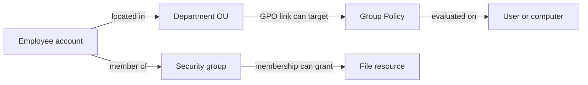

# Inside the Nova Corp directory

**[Open every directory account, group and computer](/reference/explore/DIRECTORY_SNAPSHOT_2026-11-22/)**

[← Active Directory](/reference/explore/services/ACTIVE_DIRECTORY/) · [Meet the people](/reference/explore/PEOPLE_AND_DEPARTMENTS/) · [Security groups](/reference/explore/GROUPS/) · [Group Policy](/reference/explore/POLICIES/)

An **Organizational Unit (OU)** is a folder-like container for directory objects. It helps administrators organize the company and attach policies to the right users or computers.

## Explore the directory tree

<strong>nova.corp — Company directory</strong>

<strong>Nova Users — Employee and contractor accounts</strong>

- [Finance department](/reference/explore/people/DEPARTMENTS/#finance)
- [Human Resources](/reference/explore/people/DEPARTMENTS/#human-resources)
- [IT department](/reference/explore/people/IT_DEPARTMENT/) — [David](/reference/explore/people/DAVID/), [Moyo](/reference/explore/people/MOYO/), [Isaac](/reference/explore/people/accounts/cr011-it/)
- [Management](/reference/explore/people/DEPARTMENTS/#management)
- [Sales](/reference/explore/people/DEPARTMENTS/#sales)
- **Contractors** — [John Shaw](/reference/explore/people/JOHN_SHAW/), contractor test account documented in the GPO journal

<strong>Nova-Computers</strong>

- **Workstations** — [NOVA-CLIENT](/reference/explore/systems/NOVA-CLIENT/)
- **Servers** — member-server organizational area

<strong>Nova Security groups</strong>

[IT_Users](/reference/explore/GROUPS/#it_users) · [Finance_Users](/reference/explore/GROUPS/#finance_users) · [HR_Users](/reference/explore/GROUPS/#hr_users) · [Sales_Users](/reference/explore/GROUPS/#sales_users) · [Management_Users](/reference/explore/GROUPS/#management_users) · [Resource permission groups](/reference/explore/GROUPS/#resource-permission-groups)

<strong>Nova Service Accounts</strong>

- `svc_backup` — created for backup-related service identity
- `svc_monitoring` — created for future monitoring identity
- `svc_fileserver` — created for file-server-related service identity

These accounts were created during directory setup; the original journal did not claim every account was already executing a running service.

<strong>Other administrative areas</strong>

- Nova Administrative Accounts
- Nova Disabled Objects
- Nova Resources

<strong>Built-in Domain Controllers OU</strong>

- [NOVA-DC01](/reference/explore/systems/NOVA-DC01/)
- [NOVA-DC02](/reference/explore/systems/NOVA-DC02/)

Domain Controllers remain in the built-in AD organizational unit rather than the custom member-server OU.

## Current policies attached to this tree

- **Domain root:** [Password and Kerberos settings](/reference/explore/policies/DOMAIN_PASSWORD/).
- **Domain Controllers:** [Domain Controller security policy](/reference/explore/policies/DEFAULT_DC/).
- **Nova Users (parent):** [Wallpaper](/reference/explore/policies/WALLPAPER/) and [drive-mapping logon script](/reference/explore/policies/DRIVE_MAPPING/).
- **Contractors:** [USB/removable-storage restriction](/reference/explore/policies/CONTRACTOR_USB/).
- **Nova-Computers / Workstations:** [Workstation security baseline](/reference/explore/policies/WORKSTATION_BASELINE/).

These are the six **enabled Group Policy links** in Nova Corp. [All seven policy objects](/reference/explore/POLICIES/) include an unlinked keyboard GPO.

## How OUs, groups and policies relate

OU location organizes. A group membership can authorize a resource or help filter a policy. A policy link alone is not proof that the resulting setting applied.

## Explore real examples

- [Moyo's group membership and file access](/reference/explore/people/MOYO/)
- [John Shaw's contractor policy](/reference/explore/people/JOHN_SHAW/)
- [IT share permission chain](/reference/explore/FILE_SERVICES/)
- [Group Policy settings and tests](/reference/explore/POLICIES/)

**How the directory was organized:** [Original OU, user and group journal](/reference/Documentation/Change-Requests/Journal-CR-005/).

*Account placements reflect the last documented directory check.*