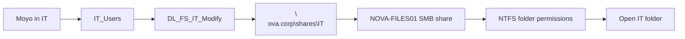

# File & Records Room — Shared files and who may open them

Employees at Nova Corp keep documents on [NOVA-FILES01](/reference/explore/systems/NOVA-FILES01/), not scattered across individual computers. **Five departmental folders** use Active Directory groups, SMB share rules and NTFS file permissions to protect their contents.

## Choose a company folder

| Department | What happens here? |
| --- | --- |
| [**IT**](/reference/explore/files/it/) | Shared technical and support files |
| [**Finance**](/reference/explore/files/finance/) | Finance documents, with special management access |
| [**HR**](/reference/explore/files/hr/) | Human Resources documents |
| [**Management**](/reference/explore/files/management/) | Management's department files |
| [**Sales**](/reference/explore/files/sales/) | Sales department documents |

[**All shares and how they connect**](/reference/explore/files/SHARES/) · [Who has which permissions?](/reference/explore/files/PERMISSIONS/) · [Technical ACL details](/reference/explore/files/TECHNICAL_ACL_DETAILS/)

## Follow an employee opening a file

The group's permissions are checked at **both** the SMB share and the folder. A working network connection isn't enough if an account lacks permission.

[Open Moyo's profile](/reference/explore/people/MOYO/) → [IT group](/reference/explore/GROUPS/#it_users) → [IT folder](/reference/explore/files/it/) → [actual access-denial investigation](/reference/explore/incidents/file-permission-denial/).

## One company address for five departments

The DFS namespace `\\nova.corp\shares` points employees to departmental folders without asking them to remember the individual server address.

[Open all five DFS targets](/reference/explore/files/DFS_PATHS/) · [How DFS works](/reference/explore/services/DFS/) · [Drive-mapping Group Policy](/reference/explore/policies/DRIVE_MAPPING/).

## Recovering files and earlier versions

The file server has **30 Shadow Copy points**, a dedicated Windows Backup volume, and a completed incident where a deleted file was restored with the **same SHA-256 hash**.

[Shadow Copies](/reference/explore/files/VSS/) · [Tested earlier-version recovery](/reference/explore/files/SHADOW_COPY_RECOVERY/) · [Disk space and backup target](/reference/explore/files/VOLUMES/) · [Windows Backup restore incident](/reference/explore/incidents/backup-target-disappears/).

## Go deeper

[Deployment journal](/journals/NovaCorp_CR-008_File_Server_Deployment_Journal/) · [Share/permission journal](/journals/NovaCorp_CR-009_Departmental_Shares_and_Drive_Mapping/) · [DFS/VSS journal](/journals/NovaCorp_CR-010_DFS_and_Shadow_Copies_CORRECTED/).

[← Company map](/reference/EXPLORE_NOVACORP/)