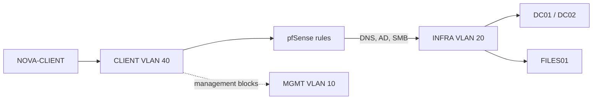

# Network Gatehouse — How Nova Corp stays connected

Nova Corp uses a **pfSense firewall** to connect the company's networks. Staff, servers, management tools and remote laptops are placed in different network areas. Each area has its own gateway, and firewall rules decide which traffic can cross.

**[Open the pfSense firewall](/reference/explore/systems/NOVA-FW01/)** · **[Inspect every firewall rule](/reference/explore/network/RULES/)** · **[See the five aliases](/reference/explore/network/ALIASES/)**

## Choose a network area

| Network | Address / gateway | What it is used for | Explore |
| --- | --- | --- | --- |
| WAN | DHCP on `vtnet0` | Connection to the upstream router | [WAN](/reference/explore/network/zones/WAN/) |
| LAN | `10.99.99.0/24` / `10.99.99.1` | Original internal network | [LAN](/reference/explore/network/zones/LAN/) |
| MGMT · VLAN 10 | `10.10.10.0/24` / `10.10.10.1` | Management interface area | [MGMT](/reference/explore/network/zones/MGMT/) |
| INFRA · VLAN 20 | `10.10.20.0/24` / `10.10.20.1` | Domain Controllers and file server | [INFRA](/reference/explore/network/zones/INFRA/) |
| APP · VLAN 30 | `10.10.30.0/24` / `10.10.30.1` | Application network for future workloads | [APP](/reference/explore/network/zones/APP/) |
| CLIENT · VLAN 40 | `10.10.40.0/24` / `10.10.40.1` | Employee test workstation | [CLIENT](/reference/explore/network/zones/CLIENT/) |
| DMZ · VLAN 50 | `10.10.50.0/24` / `10.10.50.1` | Network for future public services | [DMZ](/reference/explore/network/zones/DMZ/) |
| VPN_REMOTE · WireGuard | `10.10.60.0/24` / `10.10.60.1` | Remote-access laptop | [VPN_REMOTE](/reference/explore/network/zones/VPN_REMOTE/) |

Nova Corp has **five VLANs (10–50)**. The remote-access network is a **WireGuard VPN tunnel**, rather than a sixth VLAN.

## Follow an employee request

The two CLIENT block rules come before a more general CLIENT allow rule. [See their exact order and settings](/reference/explore/network/RULES/#client).

## Inside the firewall

Here's what makes Nova Corp's network run:

| Component | Count / configuration |
| --- | --- |
| Interfaces | **8** |
| VLAN subinterfaces | **5** |
| Explicit firewall filter rules | **17: 13 pass, 4 block** |
| Aliases | **5** |
| DHCP scopes | **6**, configured enabled |
| WireGuard | **1 enabled tunnel, 1 enabled remote peer** |
| DNS Resolver | Enabled; `nova.corp` override → DC01 |
| NAT | Automatic outbound NAT; no locally configured pfSense port-forward rule |
| Web administration | HTTPS |

VLANs separate network areas, but firewall rules determine which connections are allowed. INFRA, APP and DMZ still have broad allow rules; tighter access controls are part of the next security stage. [See a tested example](/reference/explore/incidents/pfsense-management-exposure/).

## Explore the working parts

[Firewall rule order](/reference/explore/network/RULES/) · [Network aliases](/reference/explore/network/ALIASES/) · [DHCP](/reference/explore/network/DHCP/) · [NAT and gateways](/reference/explore/network/NAT_AND_GATEWAYS/) · [DNS Resolver](/reference/explore/services/DNS/) · [Remote WireGuard VPN](/reference/explore/services/WIREGUARD/).

## What happened during testing?

The VPN initially received packets but failed to complete a handshake; the peer configuration was corrected and retested. Later, a normal workstation reached management paths more broadly than intended. The security review introduced more specific block rules, followed by tests proving both blocked management access and working business services.

[View all incidents](/reference/explore/TESTS_AND_RECOVERY/) · [Full VPN journal](/reference/Documentation/Change-Requests/Journal-CR-007/) · [Phase 2 closure](/reference/Documentation/Change-Requests/CR-015_Phase_2_Validation_and_Closure/).

*This page shows Nova Corp's latest documented network setup; it is not a live firewall dashboard.*

[← Enter Nova Corp](/reference/EXPLORE_NOVACORP/)