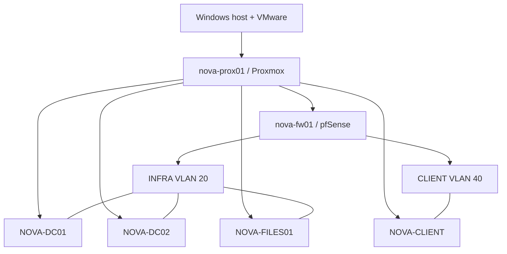

# IT Control Room — Computers and servers

Nova Corp has **six Proxmox virtual machines**: five running company VMs and one stopped, unassigned VM201. Choose a machine to see the services inside it, its network connection, disks and tests. Select one to see the services inside it, its network connection and the tests involving it.

| Machine | What it does | Open |
| --- | --- | --- |
| **NOVA-DC01** | Domain identity and DNS | [Explore DC01](/reference/explore/systems/NOVA-DC01/) |
| **NOVA-DC02** | Second domain identity and DNS; resilience | [Explore DC02](/reference/explore/systems/NOVA-DC02/) |
| **NOVA-FILES01** | Department files, DFS and backup | [Explore file server](/reference/explore/systems/NOVA-FILES01/) |
| **NOVA-CLIENT** | Windows workstation for user-facing tests | [Explore workstation](/reference/explore/systems/NOVA-CLIENT/) |
| **nova-fw01** | pfSense firewall, router and VPN | [Explore firewall](/reference/explore/systems/NOVA-FW01/) |
| **nova-prox01** | Proxmox hypervisor hosting VMs | [Explore hypervisor](/reference/explore/systems/NOVA-PROX01/) |
| **VM201** | Stopped/unassigned Windows VM configuration | [Open VM201 inventory](/reference/explore/virtualization/vms/201/) |

**[View the virtualization floor — all six VMs, two bridges and three storage backends](/reference/explore/virtualization/README/)**

## How the machines connect

The arrows distinguish the outer hosting relationship from pfSense's traffic-routing zones. Not every server "connects through" pfSense to communicate with another server in its own subnet.

## Choose a service instead

[Active Directory](/reference/explore/services/ACTIVE_DIRECTORY/) · [DNS](/reference/explore/services/DNS/) · [Kerberos/KDC](/reference/explore/services/KERBEROS/) · [LDAP](/reference/explore/services/LDAP/) · [SYSVOL/NETLOGON](/reference/explore/services/SYSVOL_NETLOGON/) · [SMB](/reference/explore/services/SMB/) · [DFS](/reference/explore/services/DFS/) · [Backup](/reference/explore/services/BACKUPS/).

## Choose a test

[DC failover](/reference/explore/incidents/domain-controller-outage/) · [File permissions](/reference/explore/FILE_SERVICES/) · [Management firewall hardening](/reference/explore/NETWORK/) · [Restore proof](/reference/explore/services/BACKUPS/).

[← Company map](/reference/EXPLORE_NOVACORP/)