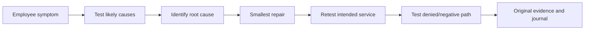

# Incident Lab — What broke, what we tested, how it recovered

**Every investigation below opens a technical walkthrough.** Start with the problem in plain English, then expand into the actual commands, expected results, observed output, root cause, repair and supporting journals.

An incident doesn't end when a VM turns green. Nova Corp tests whether employees can still sign in, find services, access the files they should, and recover after failures.

## Choose an investigation

| Investigation — click to open | The problem | Result |
| --- | --- | --- |
| **[Proxmox default gateway failure](/reference/explore/incidents/proxmox-default-gateway/)** | Local management worked, but the host couldn't reach outside networks | Repaired · validated |
| **[Proxmox WebGUI outage](/reference/explore/incidents/proxmox-webgui-outage/)** | Web console unavailable while SSH and VMs remained operational | Repaired · validated |
| **[Domain Controller VLAN migration](/reference/explore/incidents/dc01-vlan-migration/)** | DC01 lost outbound connectivity after moving into INFRA | Repaired · validated |
| **[WireGuard handshake failure](/reference/explore/incidents/wireguard-handshake/)** | Encrypted packets arrived at pfSense but peer authentication did not complete | Repaired · validated |
| **[Bulk user creation rollback](/reference/explore/incidents/bulk-users-partial-rollback/)** | Weak password left disabled, half-created user accounts | Corrected and re-tested |
| **[False denial in access-audit script](/reference/explore/incidents/group-acl-name-mismatch/)** | Group names and ACL identities didn't match as strings | Corrected · positive/negative tests |
| **[Domain Controller outage](/reference/explore/incidents/domain-controller-outage/)** | DC01 unavailable; DC02 had to carry domain services | Continuity and recovery PASS |
| **[Active Directory replication divergence](/reference/explore/incidents/replication-divergence/)** | Two healthy-looking DCs contained different AD objects | Natural convergence PASS |
| **[Single-folder NTFS denial](/reference/explore/incidents/file-permission-denial/)** | Moyo could access IT but not one child folder | Minimal ACL repair PASS |
| **[Client DNS misconfiguration](/reference/explore/incidents/dns-client-outage/)** | File share failed by name, worked by direct IP | DNS repaired PASS |
| **[Wallpaper GPO link disabled](/reference/explore/incidents/gpo-link-disabled/)** | User wallpaper stopped applying while Group Policy otherwise worked | Link repaired PASS |
| **[Backup disk failure and verified restore](/reference/explore/incidents/backup-target-disappears/)** | Backup storage was offline; recovery needed to be proven | File restored, SHA-256 exact match |
| **[Two faults, one misleading symptom](/reference/explore/incidents/two-faults-one-symptom/)** | Wrong DNS record concealed missing group membership | Both causes repaired PASS |
| **[Employee access to firewall management](/reference/explore/incidents/pfsense-management-exposure/)** | CLIENT could reach sensitive management paths | Targeted blocks + business regression PASS |
| **[Proxmox snapshot storage pressure](/reference/explore/incidents/proxmox-snapshot-pressure/)** | Twenty stale snapshots drove local-lvm to 86.73% used | Retention cleanup, 52.88% |
| **[Independent external-VPN fault test](/reference/explore/incidents/vpn-external-validation-deferred/)** | Required external test laptop was unavailable in CR-014 | **Deferred** — not reported as a pass |

## What happens inside each investigation?

Each walkthrough distinguishes **what the test was expected to show** from **what it actually showed**. Where an intermediate attempt failed, that lesson is preserved instead of erased.

## Find incidents by system

[Identity and Domain Controllers](/reference/explore/IDENTITY/) · [Network and pfSense](/reference/explore/NETWORK/) · [File server](/reference/explore/FILE_SERVICES/) · [Backups](/reference/explore/services/BACKUPS/) · [PowerShell automation](/reference/explore/AUTOMATION/) · [Group Policy](/reference/explore/POLICIES/) · [Proxmox](/reference/explore/virtualization/README/).

## Original technical evidence

The walkthroughs are readable summaries of the actual engineering records. The original sources remain available: [Proxmox failure tests](/reference/Documentation/failure-testing-report/), [WireGuard investigation](/reference/Documentation/Change-Requests/Journal-CR-007/), [PowerShell toolkit](/reference/Documentation/Change-Requests/CR-011_PowerShell_Administration_Toolkit/), [AD resilience](/reference/Documentation/Change-Requests/CR-013_Secondary_Domain_Controller_and_AD_Resilience_Journal/), [illustrated incident journal (PDF)](/journals/Nova_Corp_CR-014_Engineering_Journal_and_Evidence/), and [Phase 2 closure](/reference/Documentation/Change-Requests/CR-015_Phase_2_Validation_and_Closure/).

[← Explore Nova Corp](/reference/EXPLORE_NOVACORP/)