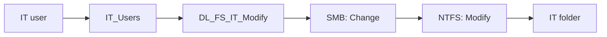

# IT shared folder — who can open it?

**Purpose:** Technology and support files.  
**Server:** [NOVA-FILES01](/reference/explore/systems/NOVA-FILES01/) · **Network:** [INFRA](/reference/explore/network/zones/INFRA/).

## Start with the folder

A member of the IT department uses the familiar path:

```text
\\nova.corp\shares\IT
```

That path enters the [company's DFS namespace](/reference/explore/files/DFS_PATHS/), which points to the real share:

```text
\\NOVA-FILES01\IT
    → D:\NovaData\IT
```

## How access works



The Global group organizes IT users. The Domain Local group is the identity written into the file permissions. Both the network share permission and NTFS permission must allow the requested action.

| Access layer | Actual setting |
|---|---|
| Department Global group | `IT_Users` |
| Resource permission group | `NOVA\DL_FS_IT_Modify` |
| SMB share access | **Allow · Change** |
| NTFS root folder access | **Allow · Modify** |
| Administrator access | **FullControl**, plus SYSTEM on NTFS |
| Permission style | NTFS entries at share root are explicit; children inherit unless overridden |


## People and departments

David Eti, Moyo Agunbiade, Isaac Technology belong to the IT OU in the documented directory. A person might have more than one authorization path through nested groups.

[Open the department directory](/reference/explore/DIRECTORY/) · [Browse security groups](/reference/explore/GROUPS/) · [See the permissions matrix](/reference/explore/files/PERMISSIONS/).

## What has actually been tested?

[The folder-permission investigation](/reference/explore/incidents/file-permission-denial/) and [the two-fault DNS+group incident](/reference/explore/incidents/two-faults-one-symptom/) show why an accessible server isn't always an accessible file. Their commands and results are available on those pages.

This page shows the **recorded share and root-folder access settings**. A per-user access result depends on that person's current groups, logon token and the precise child-folder ACL.

**[Exact ACL details](/reference/explore/files/PERMISSIONS/)** · [DFS links](/reference/explore/files/DFS_PATHS/) · [Windows file-server journal](/journals/NovaCorp_CR-009_Departmental_Shares_and_Drive_Mapping/)

[← All company file shares](/reference/explore/files/SHARES/)