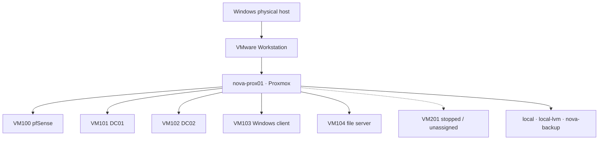

# The Virtualization Floor — How Nova Corp's computers actually run

Nova Corp's office, directory servers, file services and network firewall are **virtual machines**. A Windows computer runs VMware Workstation; inside it, **nova-prox01** runs Proxmox VE; Proxmox runs the company VMs.

Explore the machines, network switches and storage that support the company. Select any component to see what it runs and how it connects to the rest of Nova Corp.

## Enter the virtual data centre

## Open any virtual machine

| VM | Current Proxmox label | State | What it runs |
|---:|---|---|---|
| **[100](/reference/explore/virtualization/vms/100/)** | nova-fw01 | Running | pfSense firewall, VLAN routing, WireGuard |
| **[101](/reference/explore/virtualization/vms/101/)** | nova-dc01 | Running | Domain Controller, AD DS, DNS |
| **[102](/reference/explore/virtualization/vms/102/)** | nova-dc02 | Running | Second Domain Controller, DNS and resilience |
| **[103](/reference/explore/virtualization/vms/103/)** | nova-client01 | Running | The Windows workstation known inside AD as **NOVA-CLIENT** |
| **[104](/reference/explore/virtualization/vms/104/)** | nova-files01 | Running | SMB/DFS, Shadow Copies, Windows backups |
| **[201](/reference/explore/virtualization/vms/201/)** | VM-201 | **Stopped** | Unassigned spare VM; role not established |

Each VM profile lists the actual virtual NIC, VLAN tag, disks, storage backend and related business services.

## The network underneath every VM

[**vmbr0 — Outer management and firewall WAN**](/reference/explore/virtualization/bridges/vmbr0/) uses `192.168.178.26/24` on the host. [**vmbr1 — Company transit and VLAN switching**](/reference/explore/virtualization/bridges/vmbr1/) connects pfSense's internal NIC, DCs, file server and workstations. On this bridge, DC01/DC02/FILES01 use tag **20**, the Windows client uses tag **40**, and pfSense handles the five tagged networks.

**[Open the firewall and network rule explorer](/reference/explore/NETWORK/)**.

## Storage and recovery

| Storage | Space available (last check) | What is stored |
|---|---:|---|
| [local](/reference/explore/virtualization/storages/local/) | **36.88% free** | Proxmox local directory and ISO images |
| [local-lvm](/reference/explore/virtualization/storages/local-lvm/) | **46.33% free** | Thin-provisioned virtual disks and one retained snapshot |
| [nova-backup](/reference/explore/virtualization/storages/nova-backup/) | **77.70% free** | vzdump backup archives **and two active qcow2 VM disks** |

[Explore all backups, the configured schedule and retained snapshot](/reference/explore/virtualization/BACKUPS/).

Nova Corp has **six VMs**, **two main virtual switches**, **three storage areas**, **six archived VM backups**, and **one retained rollback snapshot**. For engineers: the platform has seven VM network adapters and 28 disk/media attachments; some are installation ISOs or virtual CD-ROMs, not data disks.

## Reliability tests and failures

- [Hypervisor gateway misconfiguration](/reference/explore/incidents/proxmox-default-gateway/): local network remained reachable, internet failed; recovered through configuration rollback.
- [WebGUI failure](/reference/explore/incidents/proxmox-webgui-outage/): Proxmox HTTP management died, but SSH and VMs remained usable.
- [Snapshot storage pressure](/reference/explore/incidents/proxmox-snapshot-pressure/): old snapshots pushed local-lvm to **86.73%**. Retention cleanup reduced it to **52.88%**, with **53.67% used** at the latest check.

## How do we know the machines actually work?

A VM showing “Running” doesn't tell us whether people can log in or open files. That's why we also tested the services inside: The [Domain Controller outage](/reference/explore/incidents/domain-controller-outage/), [file recovery](/reference/explore/incidents/backup-target-disappears/) and [firewall test](/reference/explore/incidents/pfsense-management-exposure/) separately demonstrate application-level behavior.

**[Full build journal](/reference/Documentation/Change-Requests/Journal-CR-001/)** · [Company systems](/reference/explore/SYSTEMS/) · [Company explorer](/reference/EXPLORE_NOVACORP/)

*Storage figures are from the latest recorded check, not a live feed. The nested lab shares one physical host; a separate virtual disk is not automatically an off-site backup.*